# Observatorio de Energía y Clima — Equipo 2
> **Proyecto Integrado IV · Integración de Información**  


> IU Digital de Antioquia | Periodo académico 2026-2

**Proyecto de integración, calidad y análisis de datos energéticos y climáticos de Colombia.**

| Entregable          | Alcance                                                  | Resultado documentado                               |
| :------------------ | :------------------------------------------------------- | :-------------------------------------------------- |
| 📦 **EA1 · Bronce** | Extracción y perfilamiento de cinco fuentes              | 14 archivos Parquet y evidencias de ejecución       |
| 🧹 **EA2 · Plata**  | Limpieza, homologación, cuarentenas y validación Pandera | 10 conjuntos limpios; ejecución integral verificada |
| 🏆 **EA2 · Oro**    | Modelo dimensional con dbt y DuckDB                      | 8 tablas, 1 vista y **33 pruebas aprobadas**        |
| 📈 **Análisis**     | Tres consultas SQL y respuestas de negocio               | Resultados y capturas documentados                  |

## 👥 Integrantes y responsabilidades

| Integrante | GitHub | Semanas 1–4 (EA1 y EA2) | Rol principal EA3 | Rol complementario EA3 |
|---|---|---|---|---|
| Sol Elena Serna Vargas | [@SernaSol](https://github.com/SernaSol) | Ingeniería de datos, arquitectura y analítica | Data Quality Analyst | Data Engineer |
| Juan Esteban Urrutia | [@estebanurrutia1](https://github.com/estebanurrutia1) | Calidad de datos, modelado BI y presentación | BI Analyst / Storyteller | Analytics Engineer |

### Responsabilidades en la Evidencia 3

**Sol Elena Serna Vargas — Data Quality Analyst / Data Engineer**

- Automatización del pipeline con GitHub Actions, incluyendo ejecuciones programadas y manuales.
- Integración de las etapas de extracción, transformación y modelado de datos.
- Desarrollo y ejecución de pruebas automatizadas con pytest.
- Validación de integridad, consistencia, granularidad y calidad de los datos.
- Verificación de las ejecuciones del pipeline y sus artefactos.
- Documentación de resultados y controles de calidad.

**Juan Esteban Urrutia — BI Analyst / Storyteller / Analytics Engineer**

- Ampliación de métricas históricas de XM.
- Desarrollo de modelos staging y marts con dbt.
- Construcción y exportación de doce tablas de la capa oro.
- Desarrollo del dashboard interactivo con Streamlit.
- Implementación de seis preguntas de negocio y filtros interactivos.
- Análisis de los indicadores energéticos, hídricos, climáticos y comerciales.
- Elaboración del informe de hallazgos y recomendaciones para la gerencia de EnerAndes.

### Trabajo colaborativo

Debido a que el equipo está conformado por dos integrantes, las responsabilidades de los cuatro roles se distribuyeron entre ambos estudiantes, asignando un rol principal y uno complementario a cada integrante.

El desarrollo se realizó mediante ramas de trabajo, commits individuales y Pull Requests revisados por otro integrante antes de su integración en `main`.


-----------------------------------------------

## 🎯 Objetivo del proyecto y pregunta de negocio
Construir un **Observatorio de Energía y Clima** que integre información del mercado eléctrico colombiano (**XM**), condiciones climáticas (**IDEAM y NOAA**), ventas de **EnerAndes** y datos territoriales oficiales del **DANE / DIVIPOLA**, para disponer de información confiable y facilitar el análisis del sector energético.

El proyecto se desarrolla de forma progresiva en tres entregas:

- **📦 EA1 — Extracción y capa bronce:** obtener datos reales de las cinco fuentes, preservar su estructura original y trazabilidad, generar muestras y documentar la calidad inicial mediante perfilamiento.

- **🧹 EA2 — Calidad, capa plata y capa oro:** limpiar y homologar los datos, validar sus reglas con Pandera, conservar registros en cuarentena y construir con dbt y DuckDB un modelo dimensional de tres tablas de hechos y cinco dimensiones, sobre el que se ejecutan consultas SQL de negocio.

- **📈 EA3 — Automatización, visualización y análisis de hallazgos:** automatizar la ejecución integral de las capas bronce, plata y oro mediante GitHub Actions, incorporar nuevas pruebas de calidad, ampliar el modelo analítico y desarrollar un dashboard interactivo en Streamlit que responda las seis preguntas de negocio. Los resultados se consolidan en un informe de hallazgos con conclusiones y recomendaciones para la gerencia de EnerAndes.

**Pregunta general de negocio:**

> ¿Qué relación existe entre las precipitaciones registradas en Antioquia, los niveles de los embalses y los precios de la energía eléctrica en Colombia durante 2025 y 2026?

**Análisis desarrollados en EA2:** comparar precio y demanda por fase ENSO, identificar las fuentes de mayor generación eléctrica y analizar las ventas de EnerAndes por municipio y segmento. Estos análisis son **descriptivos**: apoyan la toma de decisiones, pero no establecen causalidad ni resuelven por sí solos toda la pregunta general.

## 🏗️ Arquitectura general del proyecto
El Observatorio de Energía y Clima implementa una arquitectura de datos de tres capas: **bronce, plata y oro**. Durante las Evidencias 1 y 2 se desarrollaron los procesos de extracción, limpieza, validación y modelado dimensional.

En la Evidencia 3, estos procesos se integraron en un workflow de **GitHub Actions** con ejecución diaria programada y ejecución manual. El flujo comprende la extracción de cinco fuentes, la transformación y validación con Pandera, la construcción de modelos analíticos con dbt y DuckDB, la ejecución de pruebas automáticas con pytest y la exportación de doce tablas de la capa oro en formato Parquet.

Los datos de la capa oro alimentan un dashboard interactivo desarrollado en **Streamlit**, que incorpora seis análisis de negocio con filtros por fecha y otras dimensiones. Los resultados permiten presentar hallazgos y recomendaciones para la gerencia de EnerAndes.

### 🔄 Flujo del pipeline

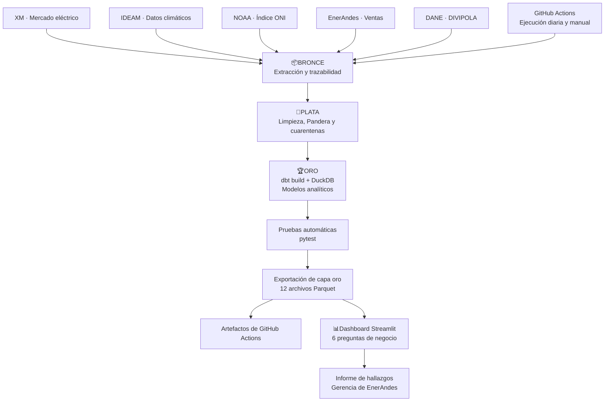


### 📋 Descripción de las capas
| Capa | Entrega | Función principal |
|---|---|---|
| 📦 **Bronce** | EA1 | Extraer y conservar los datos originales con trazabilidad. |
| 🧹 **Plata** | EA2 | Limpiar, estandarizar y validar con Pandera, separando registros inválidos en cuarentena. |
| 🏆 **Oro** | EA2 | Construir el modelo dimensional con dbt y DuckDB para el análisis de negocio. |

Los archivos originales permanecen en bronce sin modificaciones. La capa plata contiene los datos validados y la capa oro organiza la información en tablas de hechos y dimensiones.

Las instrucciones para reconstruir cada capa se encuentran en la sección **✅ Reproducibilidad y pruebas de EA2**.

---
## 📘 ENTREGA 1 — Capa bronce (EA1)
### 📦 1. Fuentes de datos y extracción
La extracción integra **cinco fuentes** y, en la ejecución documentada, produce **14 archivos Parquet** en `data/bronze/`.

| Fuente          | Acceso                                 | Archivos en `data/bronze/`                                                                                            |
| :-------------- | :------------------------------------- | :-------------------------------------------------------------------------------------------------------------------- |
| XM – Sinergox   | API REST / JSON                        | `xm_precio_bolsa`, `xm_demanda`, `xm_embalses`, `xm_generacion_recurso`, `xm_aportes_hidricos`, `xm_listado_recursos` |
| IDEAM           | API Socrata / consultas SoQL           | `ideam_precipitacion_diaria`, `ideam_temperatura_diaria`                                                              |
| NOAA            | Archivo del índice ONI                 | `noaa_oni`                                                                                                            |
| EnerAndes       | Excel 2023-2026 suministrado al equipo | `enerandes_ventas_2023`, `enerandes_ventas_2024`, `enerandes_ventas_2025`, `enerandes_ventas_2026`                    |
| DANE / DIVIPOLA | API de datos abiertos                  | `dane_divipola`                                                                                                       |

Los nombres anteriores corresponden a archivos con extensión `.parquet`.

- **XM:** extracción configurada del 1 de enero de 2024 al 30 de septiembre de 2026, usando ventanas cuando corresponde. El listado de recursos es un catálogo, no una serie histórica.

- **IDEAM:** consulta de precipitación diaria (suma) y temperatura diaria (promedio, mínimo y máximo) en Antioquia, desde el 1 de enero de 2025 hasta el 30 de septiembre de 2026. En la extracción documentada, la última fecha disponible fue el 24 de julio de 2026.

- **NOAA:** índice ONI de [Climate Prediction Center](https://www.cpc.ncep.noaa.gov/data/indices/oni.ascii.txt).

- **EnerAndes:** libro `data/insumos/ventas_enerandes_2023_2026.xlsx`, con hojas heterogéneas para 2023-2026.

- **DANE:** DIVIPOLA obtenido de [Datos Abiertos Colombia](https://www.datos.gov.co/resource/gdxc-w37w.json), para los códigos y nombres oficiales de municipios.

Los archivos originales se mantienen en bronce y conservan las columnas de trazabilidad `_fuente`, `_origen` y `_extraido_en`.

### ⚙️ 2. Instalación y ejecución de bronce
```powershell
git clone https://github.com/SernaSol/pi4-observatorio-energia-grpo-2.git

cd pi4-observatorio-energia-grpo-2

python -m venv .venv

.\.venv\Scripts\Activate.ps1

python -m pip install -r requirements.txt
```
El archivo `requirements.txt` incluye, entre otras dependencias, pandas, PyArrow, Pandera, pytest, DuckDB y `dbt-duckdb`.

**Insumo local:** ubicar el libro de Excel de EnerAndes en `data/insumos/ventas_enerandes_2023_2026.xlsx`. Sin este archivo no se puede garantizar una extracción completa desde una clonación limpia.

```powershell
New-Item -ItemType Directory -Force data/insumos
```
```powershell
python -m src.pipeline
```
Este comando ejecuta los cinco extractores, genera los archivos en `data/bronze/` y omite las descargas cuyos archivos ya existen. Para forzar nuevas consultas:

```powershell
python -m src.pipeline --forzar
```
**Actividades complementarias de EA1:**

```powershell
python -m src.generar_muestras

python -m src.perfilar_datos
```
Las muestras se guardan en `data/sample/`. El perfilamiento genera `docs/perfilamiento.md`; **volver a ejecutarlo sobrescribe ese informe**, así que se deben conservar previamente los ajustes manuales.

### 📊 3. Perfilamiento y calidad inicial
El perfilamiento de la capa bronce se obtiene mediante:

```powershell
python -m src.perfilar_datos
```
El resultado se documenta en [`docs/perfilamiento.md`](docs/perfilamiento.md), con registros, columnas, valores nulos, duplicados y cobertura temporal. Entre los hallazgos de **EA1** se registraron:

| Hallazgo en bronce                  | Evidencia                                | Observación                                                          |
| :---------------------------------- | :--------------------------------------- | :------------------------------------------------------------------- |
| Posibles duplicados en EnerAndes    | 120 filas en los archivos de 2023 a 2026 | Requerían validación durante la limpieza de EA2                      |
| Valores nulos en EnerAndes          | Hasta el 1,44 % en `col_2` de 2023       | Se necesitaba interpretar el encabezado antes de clasificar el error |
| Diferencias de estructura del Excel | 2024: 11 columnas; otros años: 10        | Exigían homologación en plata                                        |
| Cobertura IDEAM                     | Última fecha publicada: 24-07-2026       | Anterior al final solicitado: 30-09-2026                             |
| Duplicados exactos en catálogo XM   | 2 filas entre 2.493 registros            | Debían revisarse antes de cargar dimensiones                         |

Estos hallazgos corresponden al **perfilamiento inicial de bronce**, no a los conteos de datos limpios de EA2. Volver a ejecutar el script puede sobrescribir `docs/perfilamiento.md`; conviene conservar cualquier edición manual previamente.

### 🧪 4. Pruebas automáticas de EA1
Para ejecutar las pruebas automáticas del proyecto:

```powershell
python -m pytest -v
```
La captura conservada de **EA1** muestra **4 pruebas aprobadas** durante esa entrega. En **EA2** se amplió la batería de pruebas; sus resultados se presentan en la sección de reproducibilidad de la segunda entrega.

### 📸 5. Evidencias de ejecución de EA1
Estas **cinco capturas pertenecen al primer entregable** y no deben confundirse con la ejecución de pruebas de EA2.

**1. Pipeline de extracción**

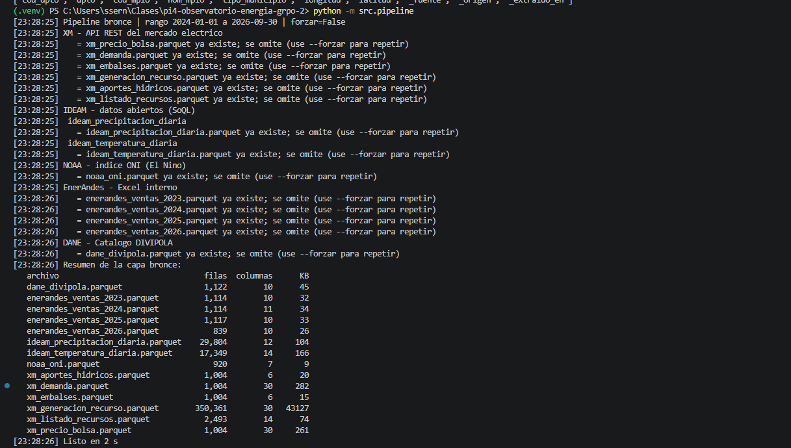

**2. Pruebas de Python de EA1**

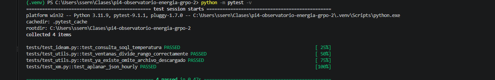

**3. Muestras CSV**

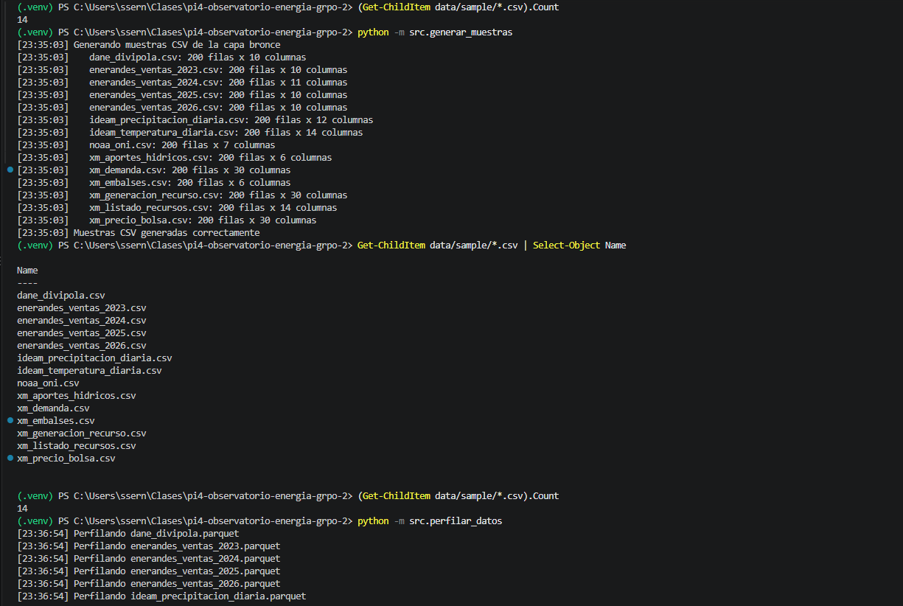

**4. Perfilamiento de bronce**

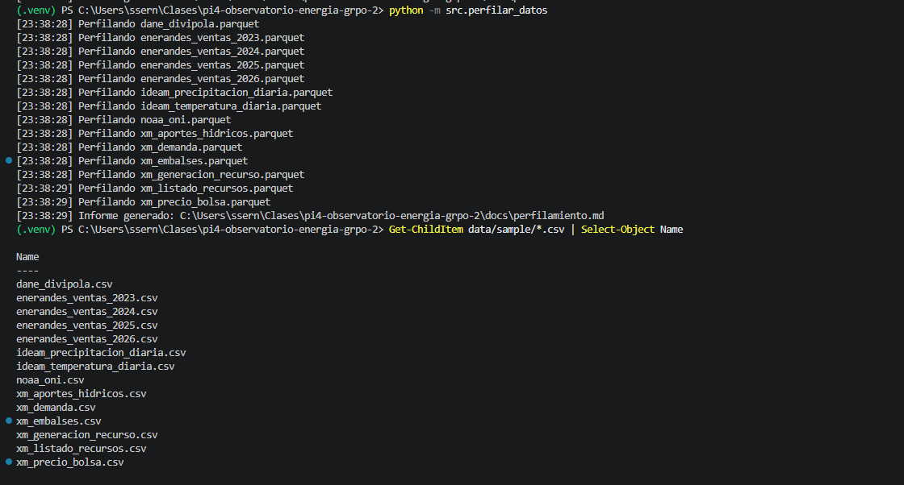

**5. Fuente DIVIPOLA**

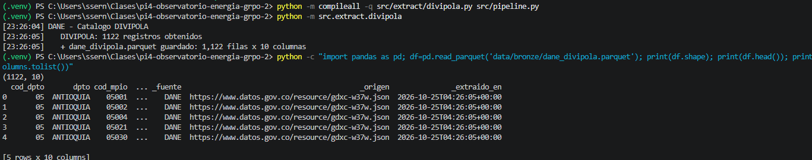

---
## 📗 ENTREGA 2 — Capas plata y oro (EA2)
### 🧹 1. Transformación y limpieza con Pandera
```powershell
python -m src.transformar
```
`src/transformar.py` coordina las cinco limpiezas en este orden: **DIVIPOLA → EnerAndes → IDEAM → NOAA → XM**. Comprueba los 14 insumos bronce, valida con Pandera y guarda los resultados en `data/silver/` junto con los registros en cuarentena.

> **Dependencia importante:** DIVIPOLA debe ejecutarse antes de IDEAM para realizar la homologación de municipios. XM procesa millones de valores horarios por lotes y puede requerir más recursos.

**Ejecución final verificada:**

```text
DIVIPOLA: FINALIZADO CORRECTAMENTE

EnerAndes: FINALIZADO CORRECTAMENTE

IDEAM: FINALIZADO CORRECTAMENTE

NOAA: FINALIZADO CORRECTAMENTE

XM: FINALIZADO CORRECTAMENTE

CAPA PLATA COMPLETADA

Validaciones Pandera ejecutadas
```
También es posible ejecutar cada transformación individualmente desde `src/silver/`, pero **`python -m src.transformar` es el comando único recomendado para reproducir toda la capa plata**.

### 📊 2. Resultados y reportes de calidad
Las reglas de calidad se aplican a los datos transformados con **Pandera**. Los registros rechazados se guardan en cuarentena sin alterar los archivos originales de bronce.

| Tabla limpia                           | Registros válidos | En cuarentena |
| :------------------------------------- | ----------------: | ------------: |
| EnerAndes: ventas consolidadas         |             4.007 |           163 |
| XM: mercado horario (precio y demanda) |            24.096 |             0 |
| XM: generación por recurso             |         5.935.449 |     2.473.215 |
| XM: embalses                           |             1.004 |             0 |
| XM: aportes hídricos                   |             1.004 |             0 |
| XM: catálogo de recursos               |             2.491 |             2 |
| IDEAM: precipitación                   |            29.804 |             0 |
| IDEAM: temperatura                     |            17.349 |             0 |
| NOAA: ONI                              |               920 |             0 |
| DANE: DIVIPOLA                         |             1.122 |             0 |
| **Total de las 10 tablas**             |     **6.017.246** | **2.473.380** |

Las cifras se refieren a filas de tablas con **granularidades diferentes**; por eso, los totales son un inventario de registros y no una medida energética agregable. Las cuarentenas se conservan para auditoría. El detalle de reglas y motivos está en [`docs/reporte_calidad.md`](docs/reporte_calidad.md), [`docs/reporte_calidad_enerandes.md`](docs/reporte_calidad_enerandes.md) y [`docs/reporte_calidad_xm_generacion.md`](docs/reporte_calidad_xm_generacion.md).

### 🏗️ 3. Modelo dimensional con dbt y DuckDB
El modelo implementa una **constelación de estrellas**: tres tablas de hechos y cinco dimensiones relacionadas directamente mediante claves.

| Tipo      | Modelo                    | Grano                                       |
| :-------- | :------------------------ | :------------------------------------------ |
| Hecho     | `fact_ventas_mensual`     | Mes + municipio + segmento + tipo de compra |
| Hecho     | `fact_mercado_horario`    | Fecha + hora + entidad + código             |
| Hecho     | `fact_generacion_recurso` | Fecha + hora + recurso                      |
| Dimensión | `dim_mes`                 | Mes                                         |
| Dimensión | `dim_municipio`           | Municipio                                   |
| Dimensión | `dim_segmento`            | Segmento comercial                          |
| Dimensión | `dim_fecha`               | Día, con fase ENSO                          |
| Dimensión | `dim_recurso`             | Recurso de generación                       |

#### 🔗 Diagrama entidad-relación del modelo dimensional
El siguiente diagrama muestra las relaciones entre las **tres tablas de hechos** y las **cinco dimensiones** de la capa oro. Se mantiene el mismo modelo documentado en [`docs/modelo_dimensional.md`](docs/modelo_dimensional.md).

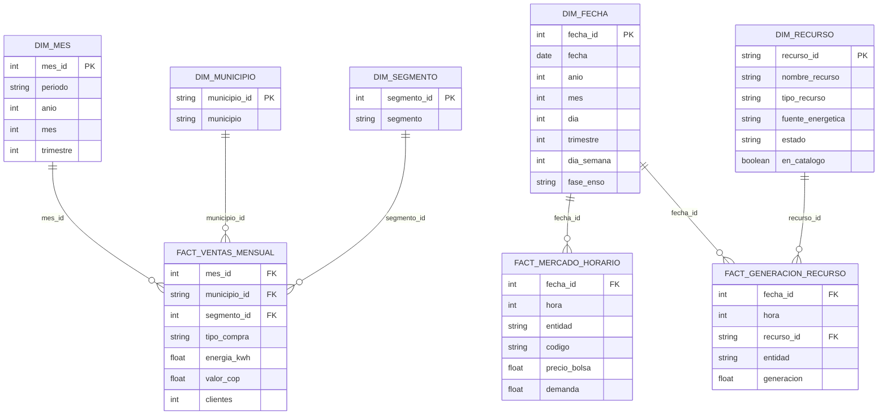
Los **10 códigos históricos** de generación ausentes en el catálogo XM se incluyen en `dim_recurso` con `en_catalogo = false`, sin inventar sus atributos y sin perder las 22.003 observaciones horarias asociadas.

Documentación: [`docs/modelo_dimensional.md`](docs/modelo_dimensional.md) y [`docs/diccionario_datos.md`](docs/diccionario_datos.md). La conexión de dbt se encuentra en `dbt/profiles.yml` y utiliza `data/observatorio.duckdb`.

### 📈 4. Consultas SQL y respuestas de negocio
Se ejecutaron las tres consultas SQL de la carpeta [`consultas/oro/`](consultas/oro/) sobre la **capa oro**, y las capturas originales se guardaron en `docs/evidencias_consultas/`.

#### 🌊 Consulta 1. ¿Cómo varían el precio de bolsa y la demanda según la fase ENSO?
**Archivo:** [`01_precio_demanda_enso.sql`](consultas/oro/01_precio_demanda_enso.sql).

**Resultados completos** (las cinco combinaciones de año y fase registradas):

| Año  | Fase ENSO | Registros horarios | Precio de bolsa promedio | Demanda promedio |
| :--- | :-------- | -----------------: | -----------------------: | ---------------: |
| 2025 | La Niña   |              2.208 |                   222,83 |     9.650.512,14 |
| 2025 | Neutral   |              6.552 |                   246,14 |     9.460.926,48 |
| 2026 | El Niño   |              2.952 |                   697,38 |    10.154.755,71 |
| 2026 | Neutral   |              2.880 |                   208,03 |     9.744.750,60 |
| 2026 | Sin dato  |                720 |                   676,95 |    10.373.311,88 |

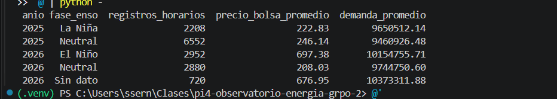

**Respuesta de negocio:** durante 2025, el precio medio de bolsa asociado con La Niña (222,83) fue menor que durante la fase Neutral (246,14). Durante 2026, El Niño presentó un precio medio de 697,38, frente a 208,03 en fase Neutral. La observación es descriptiva y **no implica causalidad**; las fases cubren intervalos diferentes del tiempo. La categoría `Sin dato` corresponde a fechas sin emparejamiento disponible con ONI.

#### ⚡ Consulta 2. ¿Qué fuentes energéticas aportaron más generación en 2025 y 2026?
**Archivo:** [`02_generacion_por_fuente.sql`](consultas/oro/02_generacion_por_fuente.sql).

**Resultados completos de la captura de consola**. Los importes de la generación con notación `e+` reflejan la precisión visualizada en la terminal; los tres primeros de cada año se muestran con decimales exactos a partir de la salida adicional de verificación.

| Año  | Fuente energética           | Recursos | Registros horarios | Generación total reportada |
| :--- | :-------------------------- | -------: | -----------------: | -------------------------: |
| 2025 | AGUA                        |      153 |          1.090.401 |          68.099.361.311,66 |
| 2025 | GAS                         |       37 |            147.759 |           6.516.305.547,21 |
| 2025 | RAD SOLAR                   |      214 |            637.571 |           4.473.803.713,71 |
| 2025 | CARBON                      |       18 |             50.062 |               3,564212e+09 |
| 2025 | BAGAZO                      |       14 |             99.584 |               8,852053e+08 |
| 2025 | COMBUSTOLEO                 |        2 |              8.761 |               5,454459e+08 |
| 2025 | VIENTO                      |        3 |             19.259 |               1,548648e+08 |
| 2025 | ACPM                        |        3 |                595 |               7,822166e+07 |
| 2025 | BIOMASA                     |        2 |              8.435 |               4,001184e+07 |
| 2025 | BIOGAS                      |        5 |             24.504 |               2,522028e+07 |
| 2025 | Sin informacion en catalogo |        6 |              8.403 |               2,255643e+07 |
| 2025 | GLP                         |        1 |                151 |               5,851272e+06 |
| 2025 | JET-A1                      |        1 |                 67 |               8,180189e+05 |
| 2026 | AGUA                        |      153 |            802.259 |          47.528.319.551,89 |
| 2026 | GAS                         |       36 |            100.799 |           6.700.792.138,77 |
| 2026 | CARBON                      |       18 |             64.615 |           5.420.085.865,57 |
| 2026 | RAD SOLAR                   |      372 |            883.947 |               5,229448e+09 |
| 2026 | BAGAZO                      |       14 |             71.676 |               6,855717e+08 |
| 2026 | COMBUSTOLEO                 |        3 |              7.467 |               4,277581e+08 |
| 2026 | ACPM                        |        3 |              1.524 |               2,432397e+08 |
| 2026 | VIENTO                      |        3 |             16.560 |               1,552257e+08 |
| 2026 | BIOMASA                     |        2 |              8.806 |               6,873335e+07 |
| 2026 | JET-A1                      |        1 |                592 |               2,125990e+07 |
| 2026 | BIOGAS                      |        6 |             18.806 |               1,524568e+07 |
| 2026 | Sin informacion en catalogo |        1 |              1.253 |               4,505280e+06 |

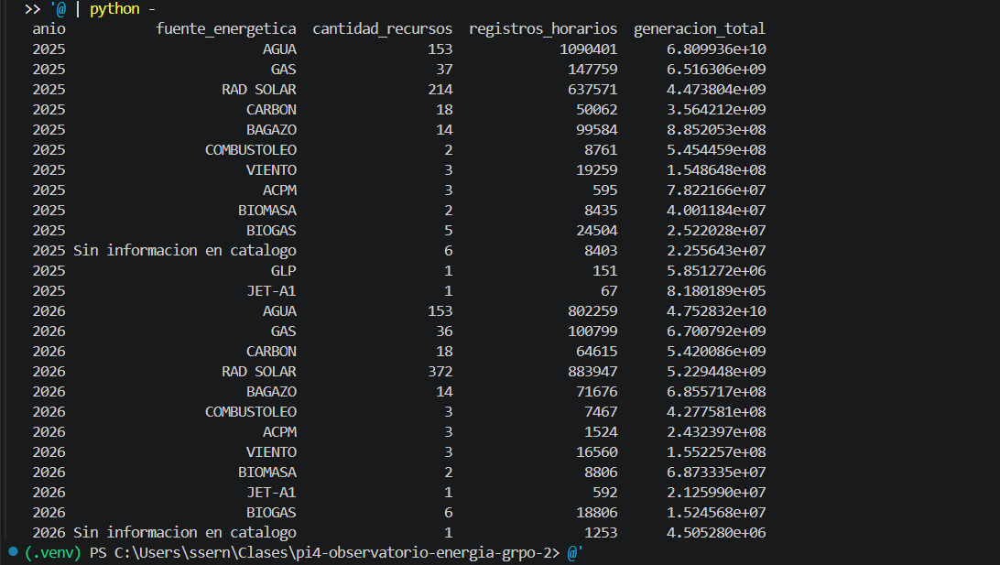

**Respuesta de negocio:** AGUA ocupa la primera posición en ambos años; en 2025 la siguen GAS y RAD SOLAR, y en 2026 GAS y CARBON. Esto evidencia el peso de la generación asociada al recurso hídrico en el conjunto analizado. La unidad física exacta de `generacion` debe comprobarse contra los metadatos de XM antes de expresar sumas en MWh o GWh. El catálogo no cubre todos los recursos históricos, de ahí la categoría sin información.

#### 🏙️ Consulta 3. ¿Qué municipios y segmentos concentran las mayores ventas de EnerAndes?
**Archivo:** [`03_ventas_municipio_segmento.sql`](consultas/oro/03_ventas_municipio_segmento.sql).

**Resultados completos:** 10 primeras combinaciones de municipio y segmento por año. Los valores `e+` de facturación conservan el redondeo de la captura de consola; las tres primeras filas por año se recuperaron con mayor precisión de la salida de verificación.

| Año  | Posición | Municipio | Segmento    | Meses registrados | Energía vendida (kWh) | Valor facturado (COP) |
| :--- | -------: | :-------- | :---------- | ----------------: | --------------------: | --------------------: |
| 2025 |        1 | Medellín  | Residencial |                12 |           147.618.494 |       153.013.703.375 |
| 2025 |        2 | Medellín  | Industrial  |                12 |           112.373.719 |       109.670.830.517 |
| 2025 |        3 | Medellín  | Comercial   |                12 |            81.639.018 |        97.802.299.184 |
| 2025 |        4 | Bello     | Residencial |                12 |            38.395.670 |          3,972255e+10 |
| 2025 |        5 | Bello     | Industrial  |                12 |            29.123.201 |          2,785583e+10 |
| 2025 |        6 | Itagüí    | Residencial |                12 |            28.262.920 |          2,930448e+10 |
| 2025 |        7 | Envigado  | Residencial |                12 |            25.231.477 |          2,610400e+10 |
| 2025 |        8 | Itagüí    | Industrial  |                12 |            20.999.048 |          2,044197e+10 |
| 2025 |        9 | Bello     | Comercial   |                12 |            19.568.466 |          2,349608e+10 |
| 2025 |       10 | Envigado  | Industrial  |                12 |            18.555.979 |          1,810089e+10 |
| 2026 |        1 | Medellín  | Residencial |                 9 |           115.719.258 |       129.581.551.324 |
| 2026 |        2 | Medellín  | Industrial  |                 9 |            85.994.552 |        90.310.434.199 |
| 2026 |        3 | Medellín  | Comercial   |                 9 |            62.601.897 |        80.893.758.461 |
| 2026 |        4 | Bello     | Residencial |                 9 |            28.347.519 |          3,191784e+10 |
| 2026 |        5 | Bello     | Industrial  |                 9 |            22.130.831 |          2,337150e+10 |
| 2026 |        6 | Itagüí    | Residencial |                 9 |            22.099.469 |          2,474863e+10 |
| 2026 |        7 | Envigado  | Residencial |                 9 |            19.583.833 |          2,196659e+10 |
| 2026 |        8 | Itagüí    | Industrial  |                 9 |            16.416.485 |          1,721054e+10 |
| 2026 |        9 | Bello     | Comercial   |                 9 |            15.752.445 |          2,038925e+10 |
| 2026 |       10 | Rionegro  | Residencial |                 9 |            14.024.237 |          1,569117e+10 |

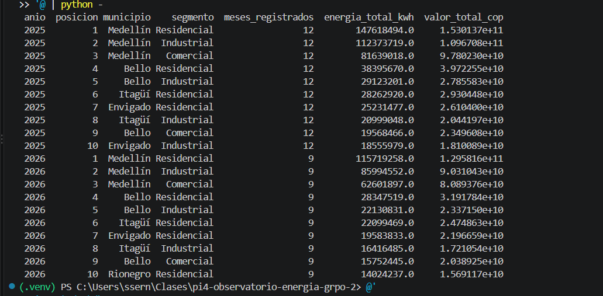

**Respuesta de negocio:** Medellín aparece en las tres primeras posiciones de los dos años, con el segmento residencial a la cabeza, seguido por el industrial y el comercial. El análisis permite priorizar segmentos y municipios para seguimiento de ventas. **No debe concluirse que las ventas disminuyeron en 2026:** la consulta compara 12 meses de 2025 frente a solo 9 meses de 2026.

#### 🔎 Consideraciones para interpretar los resultados
1\. Las comparaciones de totales de 2025 y 2026 deben ajustarse por los meses realmente observados.

2\. La clasificación ENSO proviene del ONI de NOAA asignado al mes central de cada trimestre móvil.

3\. `Sin dato` (ENSO) y `Sin informacion en catalogo` (XM) indican faltantes documentados, no valores inventados.

4\. Los resultados no prueban relaciones de causa y efecto.

5\. Para las magnitudes de XM se conservan los valores de origen; confirmar la unidad en los metadatos del indicador.

### 📸 5. Evidencias de ejecución de EA2
Las siguientes capturas muestran la ejecución completa de las

capas plata y oro, junto con sus validaciones de calidad.

#### 🥈 1. Ejecución y validación de la capa plata
**Comando ejecutado:** `python -m src.transformar`

**Captura 1.** Inicio de la transformación: limpieza de DIVIPOLA,

consolidación de ventas EnerAndes y procesamiento de precipitación IDEAM.

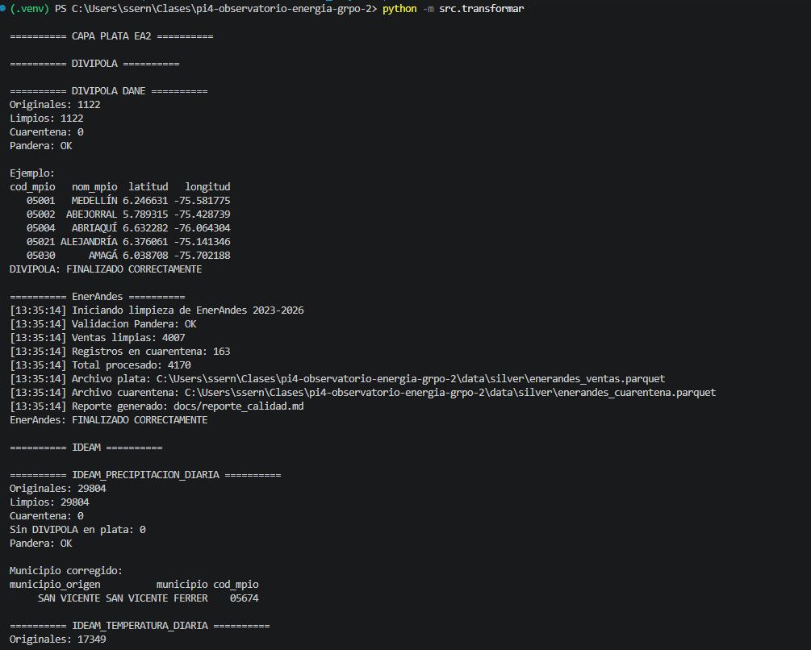

**Captura 2.** Finalización de IDEAM, validación del índice ONI de NOAA

e inicio de la transformación de los datos horarios de XM.

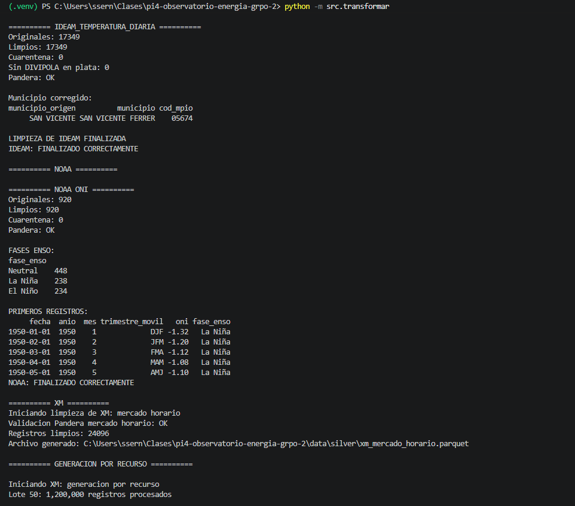

**Captura 3.** Procesamiento por lotes de generación XM, separación de

registros en cuarentena, validación de embalses, aportes hídricos y

catálogo de recursos.

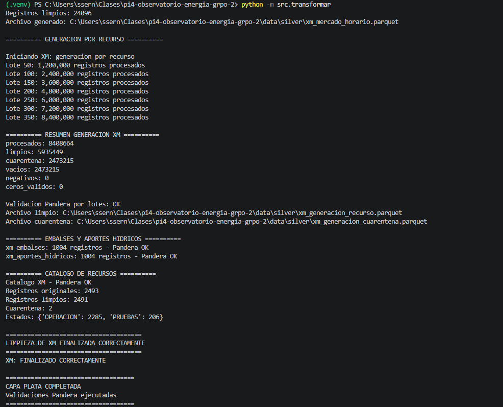

**Resultado:** Las cinco fuentes finalizaron correctamente.

Se generaron los archivos de la capa plata y se ejecutaron

las validaciones de Pandera.

`CAPA PLATA COMPLETADA — Validaciones Pandera ejecutadas`

#### 🥇 2. Construcción y validación de la capa oro
**Comando ejecutado:** `dbt build --project-dir dbt --profiles-dir dbt`

**Captura 1.** Inicio de dbt, construcción de las dimensiones,

creación de la vista staging y ejecución de las primeras pruebas.

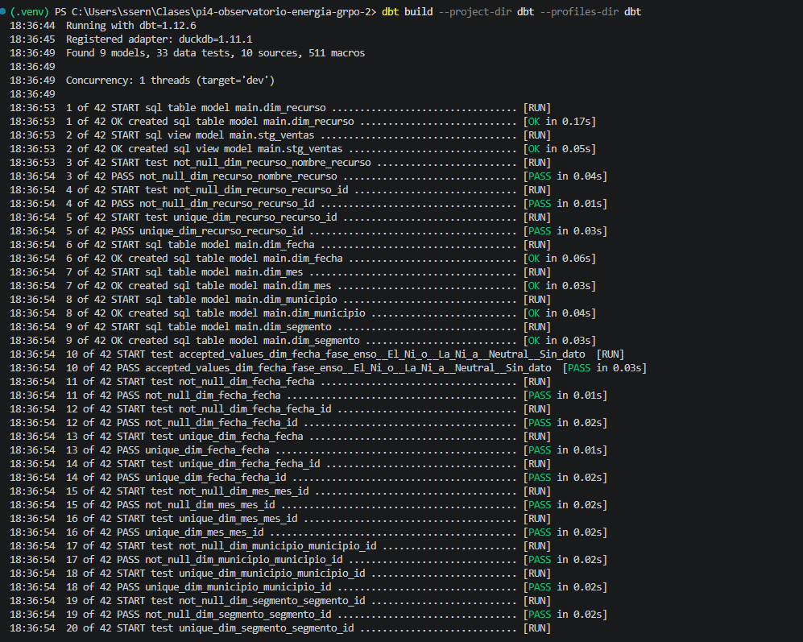

**Captura 2.** Construcción de las tablas de hechos, comprobación

de relaciones, unicidad, valores obligatorios y granularidad.

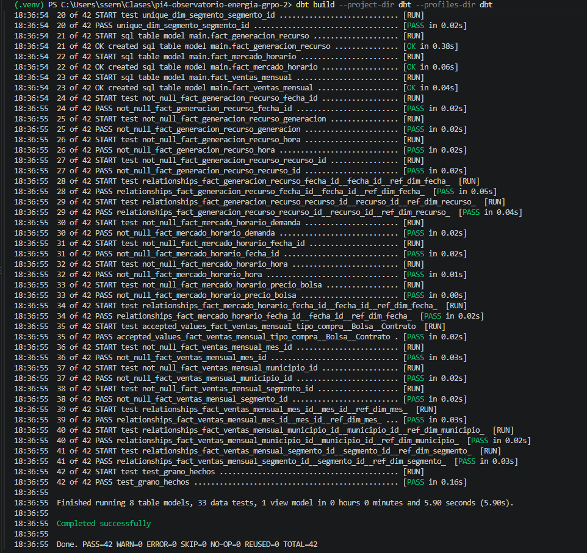

**Resultado:** Se construyeron 8 tablas y 1 vista, y se aprobaron

las 33 pruebas de datos de dbt.

**Resultado final:** `PASS=42 WARN=0 ERROR=0`

### ✅ 6. Reproducibilidad y pruebas de EA2
**Orden recomendado desde la raíz del repositorio** (con el entorno virtual activo y los insumos disponibles):

```powershell
# 1. Obtener la capa bronce, si aún no está disponible

python -m src.pipeline

# 2. Reconstruir la capa plata con todas sus validaciones

python -m src.transformar

# 3. Ejecutar las pruebas automáticas de Python

python -m pytest -v

# 4. Reconstruir la capa oro y validar el modelo

dbt build --project-dir dbt --profiles-dir dbt
```
La tercera y cuarta instrucciones son independientes: `pytest` valida el código Python y `dbt build` verifica los modelos y los datos de oro. Para el paso 4, primero deben existir los Parquet de plata.

#### 🏆 Resultado verificado de dbt
```powershell
dbt build --project-dir dbt --profiles-dir dbt
```
Este comando utiliza los Parquet de plata, materializa el modelo de DuckDB en `data/observatorio.duckdb` y valida su calidad y relaciones mediante dbt.

**Resultado final verificado en consola:**

```text
Finished running 8 table models, 33 data tests, 1 view model

Completed successfully

Done. PASS=42 WARN=0 ERROR=0 SKIP=0 NO-OP=0 REUSED=0 TOTAL=42
```
| Verificación dbt                            | Cantidad |       Estado      |
| :------------------------------------------ | -------: | :---------------: |
| Tablas materializadas                       |        8 |         ✅         |
| Vista staging                               |        1 |         ✅         |
| Pruebas de datos (incluida la granularidad) |       33 |         ✅         |
| **Total de ejecuciones**                    |   **42** | **✅ Sin errores** |

#### 🧪 Pruebas Python de EA2
```powershell
python -m pytest -v
```
**Última ejecución documentada de EA2:** 26 pruebas aprobadas. Estas son pruebas de Python y son independientes de las 33 pruebas de datos de dbt. Las cuatro pruebas mostradas en la evidencia de EA1 pertenecen a una ejecución anterior.

#### 🔍 Reproducir las tres consultas SQL
Tras finalizar `dbt build`, ejecutar desde PowerShell las tres consultas SQL guardadas en `consultas/oro/`:

```powershell
@'

import duckdb

from pathlib import Path

con = duckdb.connect('data/observatorio.duckdb', read_only=True)

for ruta in sorted(Path('consultas/oro').glob('*.sql')):

    print('\n===', ruta.name, '===')

    print(con.execute(ruta.read_text(encoding='utf-8')).df().to_string(index=False))

con.close()

'@ | python -
```
**Alcance de la verificación:** la ejecución se realizó con los archivos bronce existentes localmente. Para comprobar una reproducción íntegra desde un clon limpio también debe disponerse del Excel de EnerAndes y acceso a las fuentes externas.


---

## 📙 ENTREGA 3 — Automatización, dashboard y hallazgos (EA3)

### ⚙️ 1. Automatización del pipeline con GitHub Actions

En la Evidencia 3 se implementó la automatización del Observatorio de Energía y Clima mediante GitHub Actions, utilizando el archivo `.github/workflows/pipeline.yml`.

El workflow `pipeline-observatorio` permite ejecutar el procesamiento integral de los datos sin intervención manual, desde la extracción de las fuentes originales hasta la generación y publicación de los archivos de la capa oro.

**Modalidades de ejecución:**

| Disparador | Descripción |
|---|---|
| `schedule` | Ejecución automática diaria a las 11:00 UTC (6:00 a. m. de Colombia). |
| `workflow_dispatch` | Ejecución manual desde la pestaña Actions, con la opción de forzar la extracción de las fuentes. |
| `pull_request` | Ejecución automática cuando se abre o actualiza un Pull Request dirigido a `main`. |

**Etapas del workflow:**

| Etapa | Proceso | Herramienta |
|---|---|---|
| 1 | Instalación del entorno Python 3.11 y dependencias | Python / pip |
| 2 | Extracción de las cinco fuentes y generación de datos bronce | Python |
| 3 | Restauración y almacenamiento de caché de bronce | GitHub Actions Cache |
| 4 | Limpieza, homologación y validaciones de la capa plata | Python / Pandera |
| 5 | Construcción y validación de los modelos de la capa oro | dbt / DuckDB |
| 6 | Ejecución de pruebas automatizadas | pytest |
| 7 | Exportación de doce tablas de la capa oro en formato Parquet | Python / PyArrow |
| 8 | Publicación de los archivos de oro y del reporte de calidad | GitHub Actions Artifacts |

El workflow utiliza mecanismos de caché para reutilizar archivos de extracción y reducir consultas innecesarias a las fuentes externas. Los artefactos publicados permiten consultar los resultados generados durante cada ejecución exitosa.

**Workflow del proyecto:** [Consultar GitHub Actions](https://github.com/SernaSol/pi4-observatorio-energia-grpo-2/actions/workflows/pipeline.yml).

**Estado del pipeline:**


#### 📸 Evidencia de cinco ejecuciones exitosas

Durante la Evidencia 3 se registraron cinco ejecuciones exitosas del workflow `pipeline-observatorio`, correspondientes a los runs #2, #3, #4, #5 y #6.

Las ejecuciones incluyen la validación automática de Pull Requests y una ejecución programada mediante `schedule`, demostrando el funcionamiento de la integración continua y la automatización diaria del observatorio.

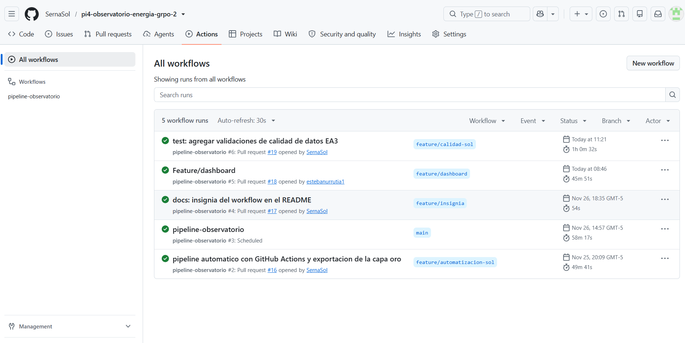


### 📊 2. Ampliación de fuentes XM y modelos analíticos de la capa oro

Durante la Evidencia 3 se amplió la cobertura histórica de los datos del mercado eléctrico colombiano y se incorporaron nuevos indicadores para responder las preguntas de negocio mediante el dashboard.

#### Ampliación de las métricas XM

Se actualizaron los procesos de extracción de XM para incorporar información histórica adicional y facilitar el análisis de precios, generación y condiciones hídricas del sistema eléctrico.

| Indicador | Ampliación realizada |
|---|---|
| Embalses | Cobertura histórica desde el 1 de enero de 2015 hasta el 30 de septiembre de 2026. |
| Aportes hídricos | Cobertura desde el 1 de enero de 2023 hasta el 30 de septiembre de 2026. |
| Precio de bolsa diario | Incorporación de datos diarios para el análisis de precios. |
| Precio de contratos | Incorporación de información para comparar precios del mercado. |
| Media histórica de aportes | Incorporación de valores de referencia para analizar el comportamiento hídrico. |
| Generación por recurso | Integración de información de generación por fuente energética. |

La extracción se realiza mediante consultas por ventanas de fechas, conservando los archivos originales en la capa bronce y su trazabilidad.

#### Ampliación del modelo analítico

Se desarrollaron nuevos modelos de staging y tablas analíticas mediante dbt y DuckDB, complementando el modelo dimensional construido durante la Evidencia 2.

**Nuevos modelos de staging:**

- `stg_xm_precio_bolsa_diario`
- `stg_xm_precio_contrato`
- `stg_xm_aportes_media`

**Nuevas tablas analíticas:**

| Modelo | Finalidad |
|---|---|
| `fact_mercado_mensual` | Analizar precios y demanda eléctrica a nivel mensual. |
| `fact_generacion_mensual` | Consolidar información de generación según el período y las fuentes energéticas. |
| `fact_indicadores_hidricos` | Relacionar los niveles de embalses y los aportes hídricos con sus referencias históricas. |
| `fact_clima_mensual` | Analizar las condiciones climáticas por municipio y período. |

También se amplió el calendario de `dim_fecha` para incorporar información desde 2015 y facilitar los análisis históricos.

#### Resultados de la capa oro

La ejecución de `dbt build` construyó satisfactoriamente los modelos y ejecutó las validaciones de datos.

| Indicador | Resultado |
|---|---:|
| Modelos de datos materializados | 12 |
| Pruebas de datos dbt | 33 |
| Total de operaciones de `dbt build` | 49 |
| Errores | 0 |
| Advertencias | 0 |
| Tablas exportadas en Parquet | 12 |

**Resultado de la ejecución:**

```text
PASS=49 WARN=0 ERROR=0
```

Para reconstruir la capa oro desde la raíz del repositorio:

```powershell
dbt build --project-dir dbt --profiles-dir dbt
```

Para exportar las tablas en formato Parquet:

```powershell
python -m src.exportar_oro
```

Los archivos generados se almacenan en `data/gold/` y se publican como artefactos mediante GitHub Actions, permitiendo su utilización en los análisis del dashboard.


### 🧪 3. Pruebas automáticas y calidad de datos

Durante la Evidencia 3 se fortalecieron los controles de calidad del Observatorio de Energía y Clima mediante pruebas automatizadas con **pytest**, validaciones con **Pandera** y pruebas de integridad del modelo analítico con **dbt**.

Estas verificaciones permiten comprobar la consistencia de los datos procesados, la correcta construcción de indicadores y el cumplimiento de las reglas de calidad definidas para las diferentes capas del observatorio.

#### Pruebas adicionales de la Evidencia 3

Se incorporó el archivo `tests/test_calidad_ea3.py`, desarrollado para validar información de la capa oro mediante consultas a la base de datos DuckDB.

| Prueba automatizada | Validación realizada |
|---|---|
| `test_calendario_sin_fechas_duplicadas` | Verifica que la dimensión calendario no contenga fechas duplicadas. |
| `test_porcentaje_aportes_hidricos_correcto` | Comprueba la consistencia del cálculo del porcentaje de aportes hídricos frente a su referencia histórica. |
| `test_clima_sin_duplicados_por_mes_municipio` | Verifica que los indicadores climáticos mensuales no presenten registros duplicados para una misma combinación de mes y municipio. |

Estas pruebas complementan las validaciones implementadas en las Evidencias 1 y 2, ampliando la cobertura sobre los modelos analíticos utilizados por el dashboard.

#### Ejecución de las pruebas

Para ejecutar todas las pruebas automatizadas desde la raíz del repositorio:

```powershell
python -m pytest -v
```

**Resultado de la validación local de la Evidencia 3:**

| Indicador | Resultado |
|---|---:|
| Pruebas pytest aprobadas | 30 |
| Pruebas nuevas EA3 | 3 |
| Pruebas fallidas | 0 |
| Tiempo aproximado de ejecución | 17,88 segundos |

Las 30 pruebas se ejecutaron satisfactoriamente en el entorno local de desarrollo.

#### 📸 Evidencia de ejecución de pytest — EA3

La ejecución de `python -m pytest -v` finalizó con 30 pruebas aprobadas y cero fallidas, incluyendo las tres nuevas validaciones de calidad de la Evidencia 3.

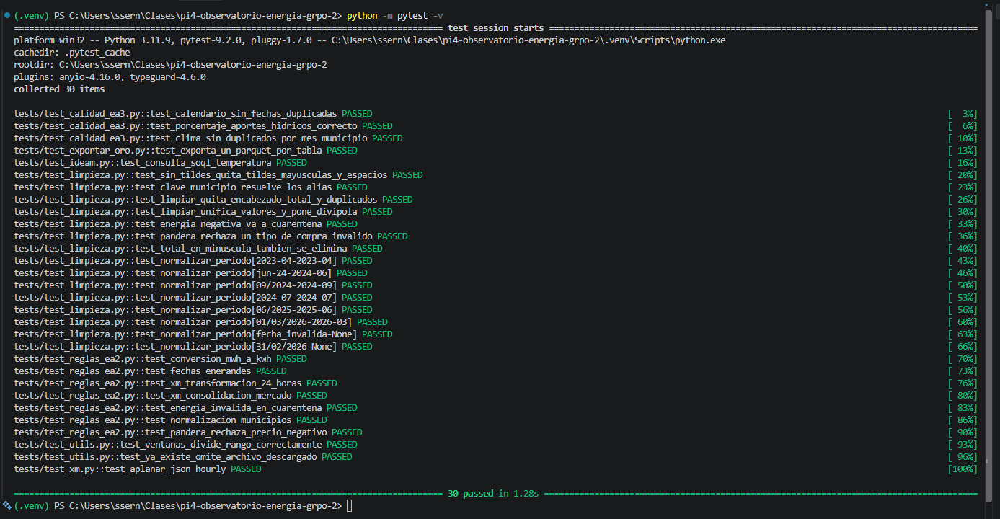

#### Integración con GitHub Actions

El workflow `.github/workflows/pipeline.yml` incorpora la ejecución de pytest después de construir y validar la capa oro mediante dbt.

El proceso automatizado ejecuta las siguientes validaciones:

1. Controles de limpieza y estructura de los datos con Pandera durante la transformación de la capa plata.
2. Pruebas de integridad, unicidad, obligatoriedad y relaciones mediante `dbt build`.
3. Ejecución de la batería de pruebas Python mediante pytest.
4. Publicación del reporte de calidad como artefacto de GitHub Actions.

La integración de estas verificaciones permite detectar errores de procesamiento y evitar que una ejecución con pruebas fallidas se considere satisfactoria.

#### 📸 Evidencia de pruebas automatizadas en GitHub Actions

La ejecución del workflow `pipeline-observatorio` permitió verificar satisfactoriamente las 30 pruebas automatizadas, incluyendo las tres nuevas pruebas de calidad desarrolladas durante la Evidencia 3.

**Resultado:** 30 pruebas aprobadas y cero fallidas.

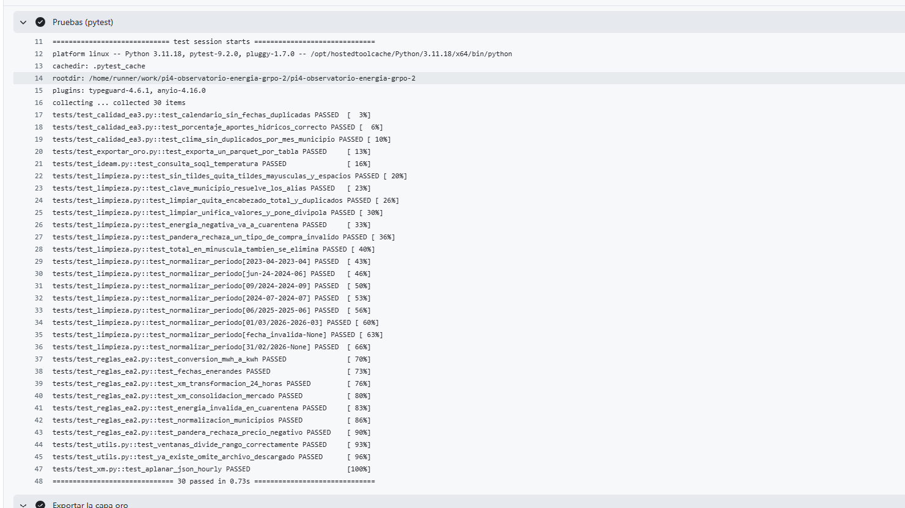

#### Evidencias de calidad

El código de las nuevas pruebas se encuentra en [`tests/test_calidad_ea3.py`](tests/test_calidad_ea3.py).

La ejecución automatizada del pipeline y sus resultados pueden consultarse en [GitHub Actions — pipeline-observatorio](https://github.com/SernaSol/pi4-observatorio-energia-grpo-2/actions/workflows/pipeline.yml).

Los controles implementados contribuyen a mantener la confiabilidad de la información utilizada para los indicadores energéticos, hídricos, climáticos y comerciales del observatorio.


### 📈 4. Dashboard interactivo en Streamlit

Durante la Evidencia 3 se desarrolló un dashboard interactivo utilizando **Streamlit**, **Python** y **Pandas**, con el propósito de visualizar los indicadores energéticos, hídricos, climáticos y comerciales del Observatorio de Energía y Clima.

La aplicación consulta los archivos Parquet generados desde la capa oro y presenta seis análisis de negocio que apoyan la interpretación de los datos y la toma de decisiones de la gerencia de EnerAndes.

#### Preguntas de negocio

| N.º | Pregunta de negocio | Indicadores y visualizaciones |
|---|---|---|
| 1 | ¿Cómo cambia el nivel de los embalses durante las diferentes fases de El Niño y La Niña? | Nivel promedio de embalses (%), registros analizados y evolución histórica. |
| 2 | ¿Cómo se comportan los aportes hídricos frente a su media histórica durante El Niño y La Niña? | Porcentaje de aportes respecto a la media histórica y evolución diaria. |
| 3 | ¿Cómo evolucionan los precios de bolsa y la demanda eléctrica durante las diferentes fases ENSO? | Precio promedio de bolsa, evolución mensual de precios y demanda eléctrica. |
| 4 | ¿Qué fuentes energéticas aportan más a la generación eléctrica y cómo cambia su participación en el tiempo? | Participación porcentual por fuente energética y evolución mensual de generación. |
| 5 | ¿Cómo varían la temperatura y la precipitación entre municipios y fases ENSO? | Temperatura media, precipitación media y comparaciones por municipio. |
| 6 | ¿Cómo evolucionan las ventas de energía y los ingresos según el segmento, municipio y tipo de compra? | Energía vendida (kWh), ingresos (COP), ventas por segmento y tipo de compra. |

#### Filtros interactivos

El dashboard permite explorar la información mediante los siguientes filtros:

| Filtro | Funcionalidad |
|---|---|
| Período de análisis | Seleccionar un rango de fechas disponible en la dimensión calendario. |
| Fase ENSO | Filtrar información según las fases de El Niño, La Niña y Neutral, de acuerdo con los datos disponibles. |
| Municipios (código DANE) | Seleccionar municipios para los análisis climáticos. |
| Segmento de clientes | Filtrar los indicadores comerciales según el segmento de EnerAndes. |
| Municipios EnerAndes | Analizar los resultados comerciales por municipio. |

Los filtros se aplican a las visualizaciones correspondientes según la información y las dimensiones disponibles para cada análisis.

#### Fuentes y modelos utilizados

El dashboard integra datos de XM, IDEAM, NOAA y EnerAndes, procesados mediante el modelo analítico de la capa oro.

Entre las principales tablas utilizadas se encuentran:

- `fact_indicadores_hidricos`: indicadores de embalses y aportes hídricos.
- `fact_mercado_mensual`: información mensual de precios y demanda.
- `fact_generacion_mensual`: generación eléctrica por recurso y período.
- `fact_clima_mensual`: temperatura y precipitación por municipio.
- `fact_ventas_mensual`: ventas de energía e ingresos comerciales.
- `dim_fecha`: calendario y clasificación ENSO.
- `dim_recurso`: clasificación de recursos y fuentes energéticas.
- `dim_municipio` y `dim_segmento`: dimensiones para los análisis comerciales.

#### Ejecución del dashboard

Desde la raíz del repositorio, con el entorno virtual activado y las dependencias instaladas, ejecutar:

```powershell
dbt build --project-dir dbt --profiles-dir dbt
python -m src.exportar_oro
streamlit run dashboard/app.py
```

La aplicación utiliza los archivos Parquet almacenados en `data/gold/`. Estos archivos deben estar disponibles antes de iniciar Streamlit.

**Código fuente:** [Dashboard del Observatorio de Energía y Clima](https://github.com/SernaSol/pi4-observatorio-energia-grpo-2/tree/main/dashboard).

#### Interpretación de los resultados

Los indicadores permiten identificar tendencias en el comportamiento de los recursos hídricos, los precios de la electricidad, la composición de la generación, las condiciones climáticas y el desempeño comercial de EnerAndes.

Las asociaciones observadas entre variables climáticas, energéticas y comerciales se presentan como análisis descriptivos y no como relaciones causales comprobadas.

Las visualizaciones constituyen la base para los hallazgos y recomendaciones del informe final dirigido a la gerencia de EnerAndes.


#### 📸 Evidencias del dashboard — EA3

Las siguientes capturas muestran el funcionamiento del dashboard interactivo desarrollado en Streamlit y las seis preguntas de negocio del Observatorio de Energía y Clima.

**Vista general del dashboard y filtros interactivos**

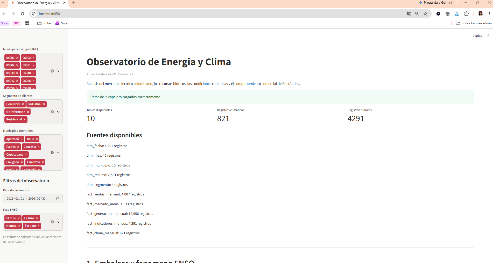

**1. Embalses y aportes hídricos**

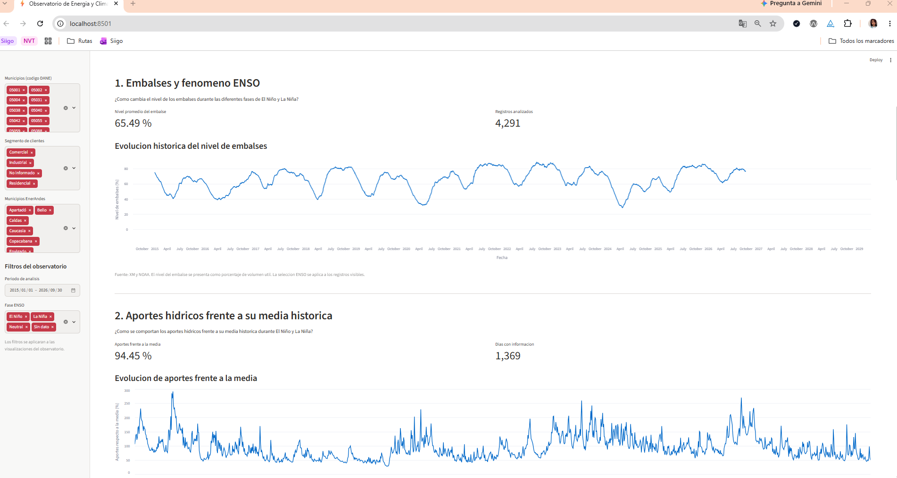

**2. Precios de bolsa y demanda eléctrica**

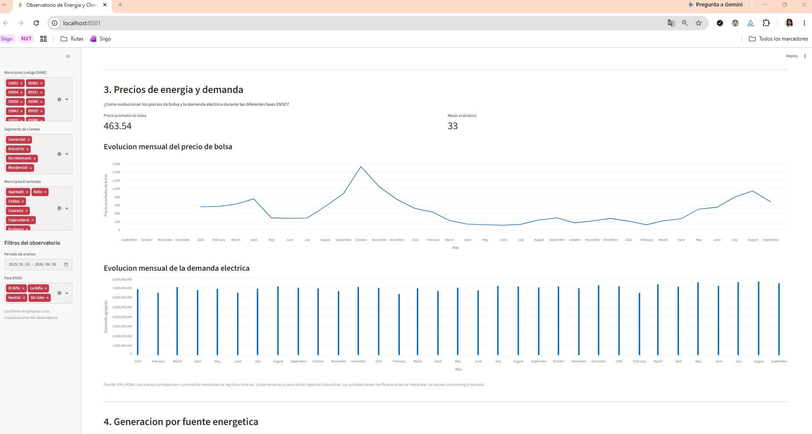

**3. Generación por fuente energética**

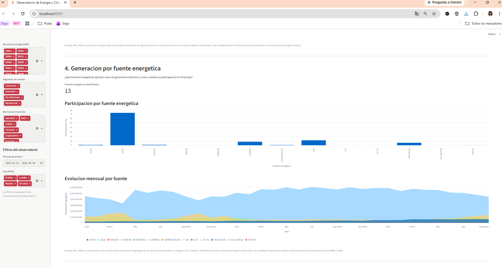

**4. Clima por municipio**

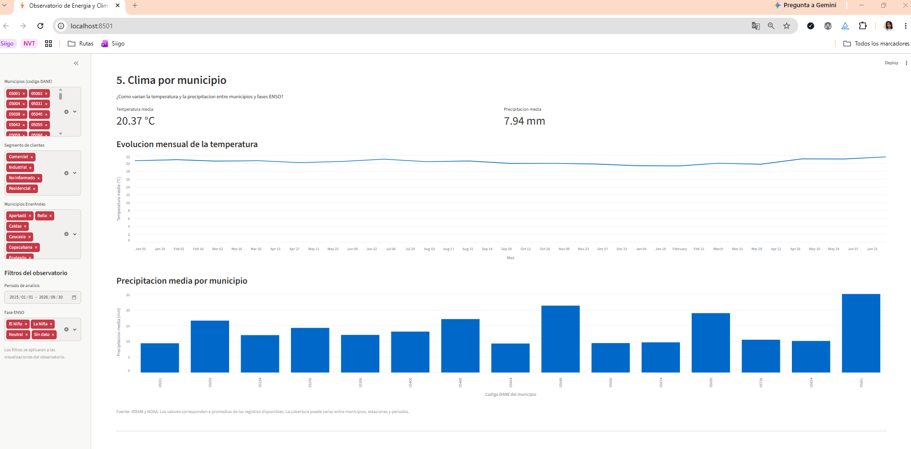

**5. Ventas e ingresos de EnerAndes**

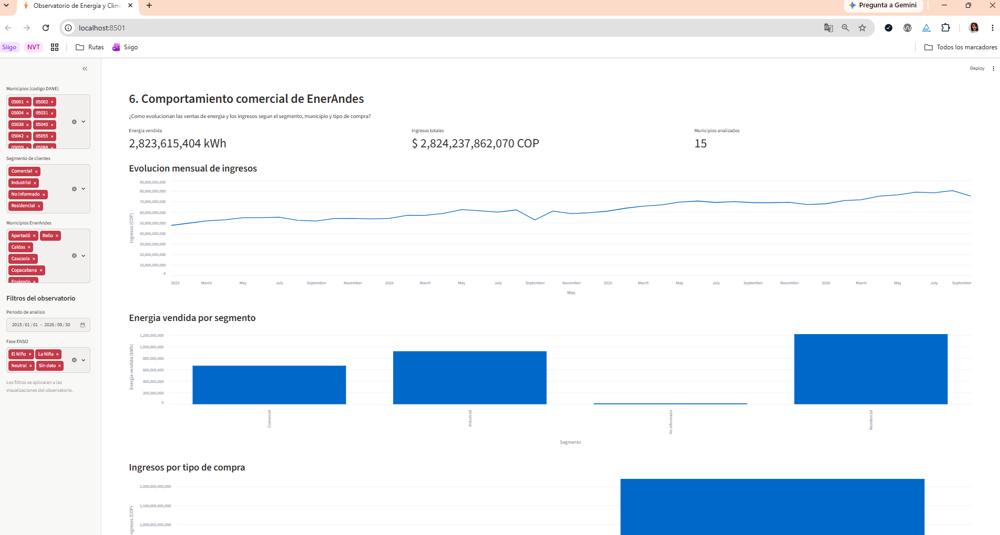

### 📊 5. Hallazgos principales y recomendaciones para EnerAndes

El Observatorio de Energía y Clima integra información histórica del mercado eléctrico colombiano, los recursos hídricos, las condiciones climáticas y las ventas de EnerAndes. Los indicadores del dashboard permiten realizar seis análisis complementarios para apoyar la toma de decisiones gerenciales.

#### 1. Niveles de embalses y fenómeno ENSO

El análisis presenta la evolución histórica del nivel de los embalses y permite comparar su comportamiento durante las diferentes fases del fenómeno ENSO.

**Recomendación:** incorporar el seguimiento de los niveles de embalses a los indicadores de riesgo de abastecimiento energético, especialmente durante períodos asociados con condiciones climáticas secas.

#### 2. Aportes hídricos frente a la media histórica

La comparación de los aportes hídricos con su media histórica permite identificar períodos en los que la disponibilidad de agua se encuentra por encima o por debajo de los valores de referencia. Un indicador del 100 % representa aportes equivalentes a la media histórica.

**Recomendación:** establecer alertas de seguimiento cuando los aportes se mantengan por debajo de su referencia histórica, para anticipar posibles riesgos asociados con la disponibilidad hídrica.

#### 3. Precios de bolsa y demanda eléctrica

Los análisis históricos de EA2 identificaron diferencias entre los precios promedio de bolsa durante distintas fases ENSO. En 2026, el precio promedio registrado durante El Niño fue de 697,38, frente a 208,03 durante la fase Neutral, según los períodos disponibles en esa entrega.

Estas diferencias representan asociaciones descriptivas y no demuestran que el fenómeno ENSO sea la causa directa de las variaciones de precios.

**Recomendación:** monitorear conjuntamente los precios de bolsa, la demanda y las condiciones climáticas para apoyar la planeación de compras de energía y la evaluación de exposición a la volatilidad del mercado.

#### 4. Generación eléctrica por fuente energética

El análisis de EA2 identificó que la generación asociada al agua ocupó la primera posición entre las fuentes energéticas durante 2025 y 2026.

El dashboard de EA3 amplía este análisis mediante visualizaciones de participación porcentual y evolución mensual de la generación por fuente.

**Recomendación:** incorporar indicadores de diversificación de fuentes energéticas y analizar la dependencia de la generación hídrica frente a posibles cambios en las condiciones climáticas.

#### 5. Temperatura y precipitación por municipio

La integración de información del IDEAM permite comparar los promedios de temperatura y precipitación entre municipios y períodos, utilizando los filtros de fecha, municipio y fase ENSO.

La cobertura de los datos depende de la disponibilidad de información publicada por las estaciones meteorológicas.

**Recomendación:** realizar seguimiento de los municipios con condiciones climáticas relevantes para la operación y utilizar los indicadores disponibles como apoyo para la identificación de riesgos territoriales.

#### 6. Ventas e ingresos de EnerAndes

Los análisis de EA2 identificaron a Medellín entre los municipios con mayores ventas de energía, destacándose los segmentos residencial, industrial y comercial.

El dashboard de EA3 incorpora filtros por municipio, segmento, tipo de compra y período de análisis, permitiendo profundizar en el comportamiento comercial.

**Recomendación:** priorizar el seguimiento de los segmentos y municipios con mayor participación en las ventas, analizar sus variaciones mensuales y evaluar estrategias de contratación de energía según la exposición comercial de EnerAndes.

#### Consideraciones para la toma de decisiones

Los hallazgos se interpretan considerando las diferencias de cobertura temporal entre las fuentes, la disponibilidad de datos y las unidades de medida de cada indicador.

Las relaciones observadas entre variables climáticas, hídricas, energéticas y comerciales son descriptivas. Las decisiones de inversión, contratación o abastecimiento requieren complementar estos resultados con análisis financieros, operativos y de riesgo.

El desarrollo completo de las seis preguntas de negocio, sus visualizaciones y las recomendaciones para la gerencia se presenta en el [informe final del Observatorio de Energía y Clima](docs/informe_final.pdf).


### 📚 6. Reproducibilidad, uso de inteligencia artificial y limitaciones

#### Reproducibilidad del proyecto

El Observatorio de Energía y Clima puede ejecutarse en un entorno de desarrollo con Python 3.11 o superior, las dependencias declaradas en `requirements.txt` y los archivos de entrada requeridos.

Desde la raíz del proyecto, con el entorno virtual activado, la ejecución completa se realiza mediante los siguientes comandos:

```powershell
python -m src.pipeline
python -m src.transformar
dbt build --project-dir dbt --profiles-dir dbt
python -m pytest -v
python -m src.exportar_oro
streamlit run dashboard/app.py
```

La extracción depende de la disponibilidad de las fuentes externas y del archivo Excel de EnerAndes. Los archivos generados en las capas bronce, plata y oro se reconstruyen durante la ejecución.

El workflow de GitHub Actions automatiza este procedimiento, ejecuta las validaciones y publica los resultados de la capa oro como artefactos descargables.

#### Uso de inteligencia artificial

Durante el desarrollo de la Evidencia 3 se utilizó **ChatGPT de OpenAI** como herramienta de apoyo para:

- Revisar la configuración del workflow de GitHub Actions.
- Apoyar el análisis de errores y la depuración de scripts.
- Organizar la documentación técnica y los resultados de validación.
- Apoyar la interpretación y presentación de indicadores de negocio.

El código, las pruebas, las ejecuciones y los resultados fueron revisados por los integrantes del equipo mediante las herramientas de desarrollo utilizadas.

#### Limitaciones del observatorio

- **Disponibilidad de las fuentes:** los procesos de extracción dependen de las API de XM, IDEAM y DANE, así como de la publicación de datos de NOAA.
- **Dependencia de insumos:** la reproducción completa requiere disponer del archivo Excel de EnerAndes.
- **Cobertura temporal:** las fuentes presentan distintos períodos de disponibilidad, por lo que las comparaciones deben considerar los intervalos efectivamente observados.
- **Calidad de datos:** los registros rechazados se conservan en cuarentena y algunos recursos históricos de XM no cuentan con clasificación completa.
- **Unidades de medida:** determinadas métricas energéticas requieren validación de sus unidades originales antes de realizar conversiones.
- **Interpretación estadística:** las asociaciones observadas entre clima, embalses, generación, precios y ventas no demuestran relaciones causales.
- **Ejecución del dashboard:** la aplicación Streamlit requiere disponer previamente de los archivos Parquet exportados desde la capa oro.


Estas consideraciones delimitan el alcance del observatorio y permiten interpretar sus resultados de forma responsable.

---
## 🤝 INFORMACIÓN COMPLEMENTARIA

### 🗂️ 1. Organización del repositorio

El proyecto está organizado por capas de procesamiento y componentes
funcionales, separando la extracción de datos (EA1), la transformación
y validación (EA2), el modelado dimensional y las consultas analíticas.

```text
pi4-observatorio-energia-grpo-2/
│
├── consultas/
│   ├── 01_precio_vs_embalses.sql
│   ├── 02_precio_por_hora.sql
│   └── oro/
│       ├── 01_precio_demanda_enso.sql
│       ├── 02_generacion_por_fuente.sql
│       └── 03_ventas_municipio_segmento.sql
│
├── data/
│   ├── bronze/                  # Datos originales - EA1
│   ├── silver/                  # Datos limpios y cuarentenas - EA2
│   ├── insumos/                 # Excel de EnerAndes
│   ├── sample/                  # 14 muestras CSV
│   └── observatorio.duckdb      # Base de datos oro generada con dbt
│
├── dbt/
│   ├── models/
│   │   ├── staging/
│   │   │   ├── sources.yml
│   │   │   └── stg_ventas.sql
│   │   └── marts/
│   │       ├── dim_fecha.sql
│   │       ├── dim_mes.sql
│   │       ├── dim_municipio.sql
│   │       ├── dim_segmento.sql
│   │       ├── dim_recurso.sql
│   │       ├── fact_ventas_mensual.sql
│   │       ├── fact_mercado_horario.sql
│   │       ├── fact_generacion_recurso.sql
│   │       └── schema.yml
│   ├── tests/
│   │   └── test_grano_hechos.sql
│   ├── dbt_project.yml
│   └── profiles.yml
│
├── docs/
│   ├── bitacoras/
│   │   ├── serna_sol.md
│   │   └── urrutia_juan_esteban.md
│   │
│   ├── evidencias/
│   │   ├── pipeline.png             
│   │   ├── pytest.png               
│   │   ├── muestras.png             
│   │   ├── perfilamiento.png        
│   │   ├── divipola.png             
│   │   ├── ea2_plata_1.png          # EA2 - Transformación
│   │   ├── ea2_plata_2.png          # EA2 - Validaciones
│   │   ├── ea2_plata_3.png          # EA2 - Resultado final
│   │   ├── ea2_dbt_1.png            # EA2 - Construcción oro
│   │   └── ea2_dbt_2.png            # EA2 - Pruebas dbt
│   │
│   ├── evidencias_consultas/
│   │   ├── consulta_01_enso.png
│   │   ├── consulta_02_generacion.png
│   │   └── consulta_03_ventas.png
│   │
│   ├── perfilamiento.md
│   ├── reporte_calidad.md
│   ├── reporte_calidad_enerandes.md
│   ├── reporte_calidad_xm_generacion.md
│   ├── modelo_dimensional.md
│   └── diccionario_datos.md
│
├── src/
│   ├── extract/                 # Extracción de las cinco fuentes
│   ├── silver/                  # Transformaciones por fuente
│   ├── quality/
│   │   └── esquemas.py          # Validaciones Pandera
│   ├── config.py
│   ├── pipeline.py              # Ejecución de bronce
│   ├── transformar.py           # Ejecución integral de plata
│   ├── generar_muestras.py
│   ├── perfilar_datos.py
│   ├── consultar.py
│   └── utils.py
│
├── tests/                       # Pruebas automáticas pytest
│
├── .gitignore
├── requirements.txt
└── README.md
```

**Consideraciones del versionamiento:**

- `data/bronze/` y `data/silver/` contienen archivos Parquet que se generan durante la ejecución y no se suben a GitHub.
- `data/observatorio.duckdb` se reconstruye mediante dbt y tampoco se versiona.
- `dbt/target/` y `dbt/logs/` contienen archivos temporales que están excluidos por `.gitignore`.
- Las consultas SQL, los modelos dbt, los scripts Python, las bitácoras y las evidencias deben conservarse en el repositorio.

**Comandos principales:**

- Capa bronce: `python -m src.pipeline`
- Capa plata: `python -m src.transformar`
- Capa oro: `dbt build --project-dir dbt --profiles-dir dbt`
- Pruebas Python: `python -m pytest -v`


---
### 👥 2. Trabajo colaborativo y videos
El equipo trabaja con Git y GitHub, ramas por funcionalidad, Pull Requests y bitácoras individuales en `docs/bitacoras/`.

| Integrante      | Video de presentación                     |
| :-------------- | :---------------------------------------- |
| Sol Serna       | [Ver video](https://youtu.be/bYMpWIKqmkc) |
| Esteban Urrutia | [Ver video](https://youtu.be/cPOe41iujWA) |

Se debe comprobar en GitHub el cumplimiento final de commits, revisiones, PR y etiqueta de entrega EA2. Los archivos grandes de datos plata, oro y la base DuckDB **no se incluyen en Git**.

### 🤖 3. Uso de inteligencia artificial y limitaciones
Se utilizó ChatGPT como apoyo para interpretar requisitos, revisar scripts, estructurar pruebas y redactar documentación técnica. Los resultados y cambios deben ser revisados, ejecutados y validados por los integrantes.

**Limitaciones conocidas:**

- La disponibilidad de datos del IDEAM depende de las publicaciones y filtros de sus fuentes.

- El Excel de EnerAndes debe estar accesible para reproducir la extracción completa.

- Las unidades de algunas métricas XM requieren validación en los metadatos originales.

- La dimensión recurso incluye códigos históricos sin descripción en el catálogo.

- Las relaciones entre precipitación, embalses y precios aún requieren análisis específicos para responder integralmente la pregunta general.

- Una ejecución con datos ya presentes no demuestra por sí sola la reproducción desde una clonación limpia.

### 📚 4. Documentación técnica
| Documento                                                                                                                                                                         | Contenido                                             |
| :-------------------------------------------------------------------------------------------------------------------------------------------------------------------------------- | :---------------------------------------------------- |
| [Perfilamiento de bronce](docs/perfilamiento.md)                             | Hallazgos y distribución de los 14 archivos de origen |
| [Reporte consolidado de calidad](docs/reporte_calidad.md)                    | Reglas y controles de EA2                             |
| [Reporte de calidad de EnerAndes](docs/reporte_calidad_enerandes.md)         | Ventas limpias y cuarentena                           |
| [Reporte de calidad de generación XM](docs/reporte_calidad_xm_generacion.md) | Procesamiento por lotes y motivos de cuarentena       |
| [Modelo dimensional](docs/modelo_dimensional.md)                             | Tablas, granularidades y diagrama de relaciones       |
| [Diccionario de datos](docs/diccionario_datos.md)                            | Columnas y descripciones de la capa oro               |
