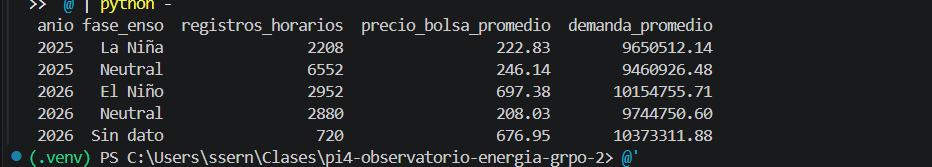
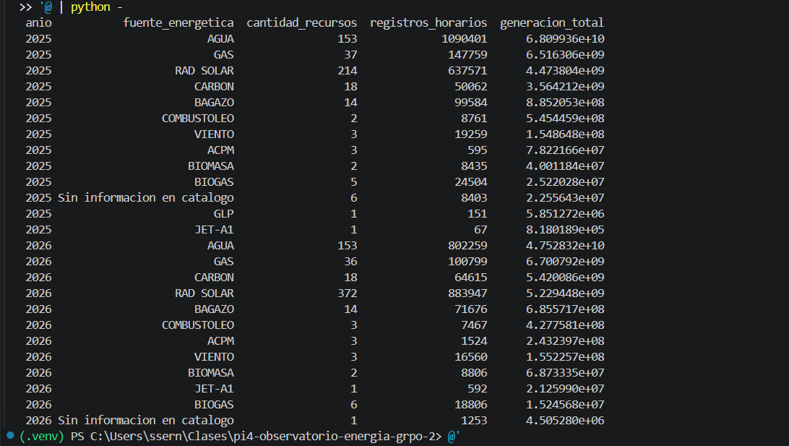
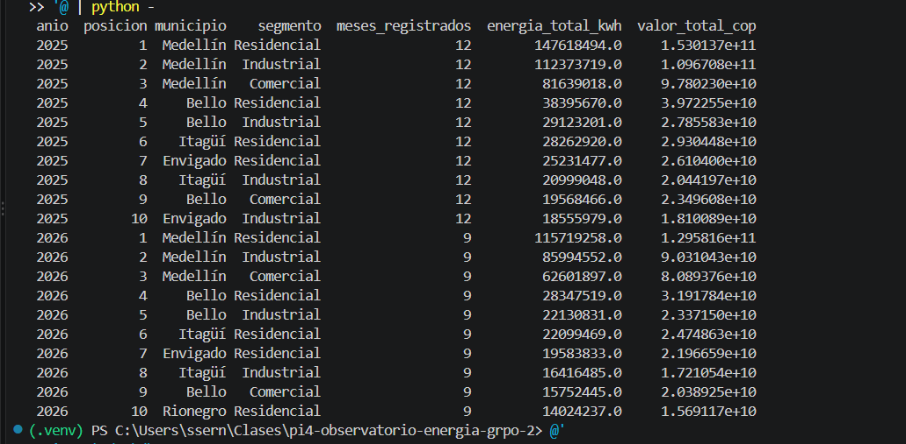
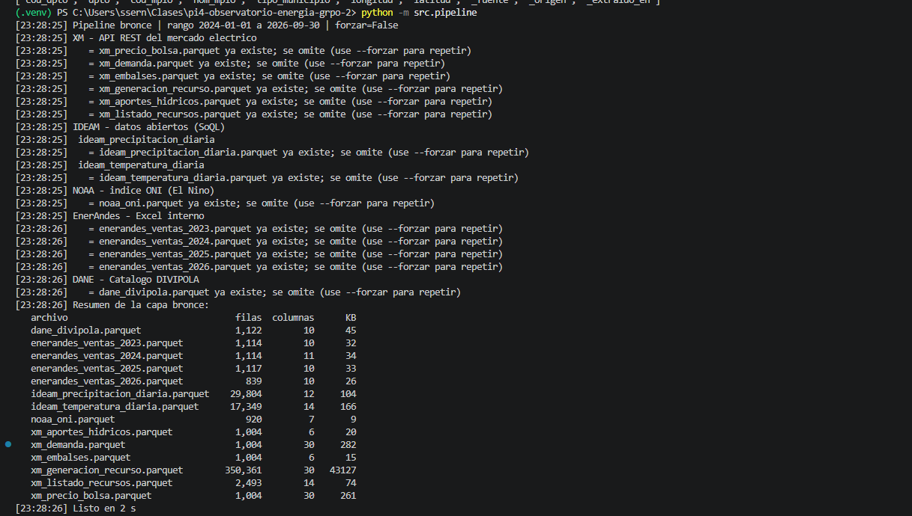
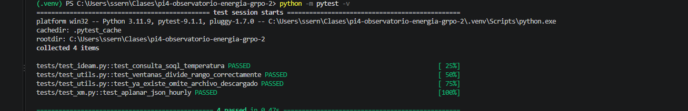
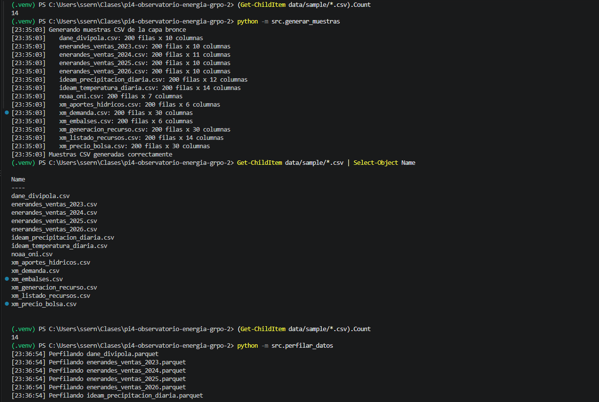
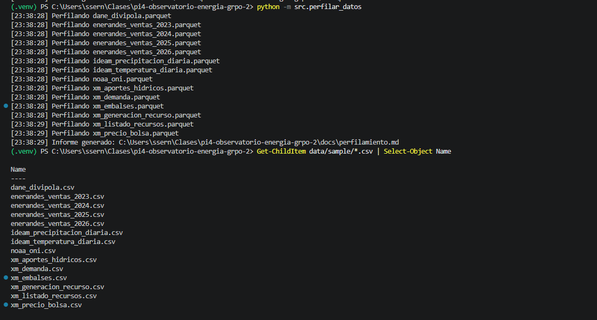
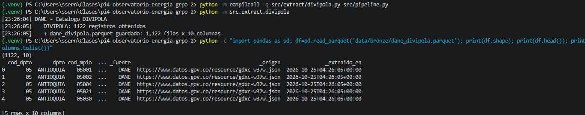

# Observatorio de Energía y Clima — Equipo 2

> Proyecto Integrado IV — Integración de Información | IU Digital de Antioquia | 2026-2

## Integrantes

| Integrante | GitHub | Responsabilidades |
|---|---|---|
| Sol Elena Serna Vargas | [SernaSol](https://github.com/SernaSol) | Data Engineering, arquitectura y analítica |
| Esteban Urrutia | [estebanurrutia1](https://github.com/estebanurrutia1) | Calidad de datos, modelado BI y presentación |

## Objetivo y pregunta de negocio

Integrar datos del mercado eléctrico colombiano (XM), las condiciones climáticas (IDEAM y NOAA), las ventas de EnerAndes y la referencia territorial del DANE para analizar relaciones entre clima, recursos hídricos y comportamiento del sector energético.

**Pregunta general:** ¿Qué relación existe entre las precipitaciones registradas en Antioquia, los niveles de los embalses y los precios de la energía eléctrica en Colombia durante 2025 y 2026?

Las consultas desarrolladas en EA2 analizan adicionalmente las fases ENSO, las fuentes de generación y las ventas comerciales. Son **análisis descriptivos**: no establecen causalidad ni resuelven por sí solos toda la pregunta general de precipitación-embalses-precio.

## 1. Fuentes de datos y capa bronce (EA1)

La extracción integra cinco fuentes y produce **14 archivos Parquet** en `data/bronze/`.

| Fuente | Acceso | Archivos en `data/bronze/` |
|---|---|---|
| XM – Sinergox | API REST / JSON | `xm_precio_bolsa`, `xm_demanda`, `xm_embalses`, `xm_generacion_recurso`, `xm_aportes_hidricos`, `xm_listado_recursos` |
| IDEAM | API Socrata / consultas SoQL | `ideam_precipitacion_diaria`, `ideam_temperatura_diaria` |
| NOAA | Archivo del índice ONI | `noaa_oni` |
| EnerAndes | Excel 2023-2026 suministrado al equipo | `enerandes_ventas_2023`, `enerandes_ventas_2024`, `enerandes_ventas_2025`, `enerandes_ventas_2026` |
| DANE / DIVIPOLA | API de datos abiertos | `dane_divipola` |

Los nombres anteriores corresponden a archivos con extensión `.parquet`.

- **XM:** extracción configurada del 1 de enero de 2024 al 30 de septiembre de 2026, usando ventanas cuando corresponde. El listado de recursos es un catálogo, no una serie histórica.
- **IDEAM:** consulta de precipitación diaria (suma) y temperatura diaria (promedio, mínimo y máximo) en Antioquia, desde el 1 de enero de 2025 hasta el 30 de septiembre de 2026. En la extracción documentada, la última fecha disponible fue el 24 de julio de 2026.
- **NOAA:** índice ONI de [Climate Prediction Center](https://www.cpc.ncep.noaa.gov/data/indices/oni.ascii.txt).
- **EnerAndes:** libro `data/insumos/ventas_enerandes_2023_2026.xlsx`, con hojas heterogéneas para 2023-2026.
- **DANE:** DIVIPOLA obtenido de [Datos Abiertos Colombia](https://www.datos.gov.co/resource/gdxc-w37w.json), para los códigos y nombres oficiales de municipios.

Los archivos originales se mantienen en bronce y conservan las columnas de trazabilidad `_fuente`, `_origen` y `_extraido_en`.

## 2. Preparación del entorno y ejecución

### Requisitos

- Python 3.11 o compatible con `requirements.txt`.
- Git, pip y conexión a internet para la extracción desde las APIs.
- dbt Core con el adaptador `dbt-duckdb` para la capa oro.
- El libro Excel de EnerAndes disponible en `data/insumos/`, si no está incluido en la copia del proyecto.

Los comandos siguientes se ejecutan desde la raíz del repositorio en **Windows PowerShell**.

```powershell
# Clonar e instalar
git clone https://github.com/SernaSol/pi4-observatorio-energia-grpo-2.git
cd pi4-observatorio-energia-grpo-2
python -m venv .venv
.\.venv\Scripts\Activate.ps1
python -m pip install -r requirements.txt

# Extraer datos a bronce
python -m src.pipeline

# Si se requiere repetir toda la descarga
# python -m src.pipeline --forzar

# Crear muestras y perfilar bronce
python -m src.generar_muestras
python -m src.perfilar_datos
```

El pipeline de extracción omite archivos ya descargados, salvo que se use `--forzar`. `src/perfilar_datos.py` regenera `docs/perfilamiento.md`, por lo que debe conservarse cualquier ajuste manual antes de ejecutarlo de nuevo.

### Transformar de bronce a plata

El orden importa: **DIVIPOLA se procesa antes de IDEAM** para asociar los municipios de las estaciones.

```powershell
python -m src.silver.divipola
python -m src.silver.enerandes
python -m src.silver.xm
python -m src.silver.ideam
python -m src.silver.noaa
```

La transformación de generación de XM trabaja por lotes y puede tardar más que las otras fuentes. Se conservan registros inválidos en archivos de cuarentena y se validan las tablas limpias con Pandera **antes de guardarlas**.

```powershell
# Pruebas automáticas de Python
python -m pytest

# Construir la capa oro y ejecutar las pruebas dbt
dbt build --project-dir dbt --profiles-dir dbt
```

**Ejecuciones verificadas durante EA2:** 26 pruebas de Python aprobadas; una ejecución de dbt completó satisfactoriamente **9 modelos (8 tablas y una vista) y 32 pruebas** (`PASS=41`). Se agregó posteriormente la prueba de granularidad `dbt/tests/test_grano_hechos.sql`; su resultado debe comprobarse con la ejecución final del equipo.

## 3. Arquitectura de datos

```text
XM -----------\
IDEAM ---------\
NOAA -----------+--> BRONCE (Parquet y linaje)
EnerAndes ------/              |
DANE ----------/               v
                       PLATA (limpieza, Pandera, cuarentena)
                                  |
                                  v
                       ORO (dbt + DuckDB)
                                  |
                       Consultas SQL y analisis
```

### Capa plata: resumen de la ejecución de EA2

| Tabla limpia | Registros válidos | En cuarentena |
|---|---:|---:|
| EnerAndes: ventas consolidadas | 4.007 | 163 |
| XM: mercado horario (precio y demanda) | 24.096 | 0 |
| XM: generación por recurso | 5.935.449 | 2.473.215 |
| XM: embalses | 1.004 | 0 |
| XM: aportes hídricos | 1.004 | 0 |
| XM: catálogo de recursos | 2.491 | 2 |
| IDEAM: precipitación | 29.804 | 0 |
| IDEAM: temperatura | 17.349 | 0 |
| NOAA: ONI | 920 | 0 |
| DANE: DIVIPOLA | 1.122 | 0 |
| **Total de las 10 tablas** | **6.017.246** | **2.473.380** |

Las cifras se refieren a filas de tablas con **granularidades diferentes**; por eso, los totales son un inventario de registros y no una medida energética agregable. Las cuarentenas se conservan para auditoría. El detalle de reglas y motivos está en [`docs/reporte_calidad.md`](docs/reporte_calidad.md), [`docs/reporte_calidad_enerandes.md`](docs/reporte_calidad_enerandes.md) y [`docs/reporte_calidad_xm_generacion.md`](docs/reporte_calidad_xm_generacion.md).

### Capa oro: modelo dimensional

El modelo implementa una **constelación de estrellas**: tres tablas de hechos y cinco dimensiones relacionadas directamente mediante claves.

| Tipo | Modelo | Grano |
|---|---|---|
| Hecho | `fact_ventas_mensual` | Mes + municipio + segmento + tipo de compra |
| Hecho | `fact_mercado_horario` | Fecha + hora + entidad + código |
| Hecho | `fact_generacion_recurso` | Fecha + hora + recurso |
| Dimensión | `dim_mes` | Mes |
| Dimensión | `dim_municipio` | Municipio |
| Dimensión | `dim_segmento` | Segmento comercial |
| Dimensión | `dim_fecha` | Día, con fase ENSO |
| Dimensión | `dim_recurso` | Recurso de generación |

Los **10 códigos históricos** de generación ausentes en el catálogo XM se incluyen en `dim_recurso` con `en_catalogo = false`, sin inventar sus atributos y sin perder las 22.003 observaciones horarias asociadas.

Documentación: [`docs/modelo_dimensional.md`](docs/modelo_dimensional.md) y [`docs/diccionario_datos.md`](docs/diccionario_datos.md). La conexión de dbt se encuentra en `dbt/profiles.yml` y utiliza `data/observatorio.duckdb`.

## 4. Resultados y respuestas de negocio — EA2

Se ejecutaron las tres consultas SQL de la carpeta [`consultas/oro/`](consultas/oro/) sobre la **capa oro**, y las capturas originales se guardaron en `docs/evidencias_consultas/`.

### Consulta 1. ¿Cómo varían el precio de bolsa y la demanda según la fase ENSO?

**Archivo:** [`01_precio_demanda_enso.sql`](consultas/oro/01_precio_demanda_enso.sql).

**Resultados completos** (las cinco combinaciones de año y fase registradas):

| Año | Fase ENSO | Registros horarios | Precio de bolsa promedio | Demanda promedio |
|---|---|---:|---:|---:|
| 2025 | La Niña | 2.208 | 222,83 | 9.650.512,14 |
| 2025 | Neutral | 6.552 | 246,14 | 9.460.926,48 |
| 2026 | El Niño | 2.952 | 697,38 | 10.154.755,71 |
| 2026 | Neutral | 2.880 | 208,03 | 9.744.750,60 |
| 2026 | Sin dato | 720 | 676,95 | 10.373.311,88 |



**Respuesta de negocio:** durante 2025, el precio medio de bolsa asociado con La Niña (222,83) fue menor que durante la fase Neutral (246,14). Durante 2026, El Niño presentó un precio medio de 697,38, frente a 208,03 en fase Neutral. La observación es descriptiva y **no implica causalidad**; las fases cubren intervalos diferentes del tiempo. La categoría `Sin dato` corresponde a fechas sin emparejamiento disponible con ONI.

### Consulta 2. ¿Qué fuentes energéticas aportaron más generación en 2025 y 2026?

**Archivo:** [`02_generacion_por_fuente.sql`](consultas/oro/02_generacion_por_fuente.sql).

**Resultados completos de la captura de consola**. Los importes de la generación con notación `e+` reflejan la precisión visualizada en la terminal; los tres primeros de cada año se muestran con decimales exactos a partir de la salida adicional de verificación.

| Año | Fuente energética | Cantidad Recursos | Registros horarios | Generación total|
|---|---|---:|---:|---:|
| 2025 | AGUA | 153 | 1.090.401 | 68.099.361.311,66 |
| 2025 | GAS | 37 | 147.759 | 6.516.305.547,21 |
| 2025 | RAD SOLAR | 214 | 637.571 | 4.473.803.713,71 |
| 2025 | CARBON | 18 | 50.062 | 3,564212e+09 |
| 2025 | BAGAZO | 14 | 99.584 | 8,852053e+08 |
| 2025 | COMBUSTOLEO | 2 | 8.761 | 5,454459e+08 |
| 2025 | VIENTO | 3 | 19.259 | 1,548648e+08 |
| 2025 | ACPM | 3 | 595 | 7,822166e+07 |
| 2025 | BIOMASA | 2 | 8.435 | 4,001184e+07 |
| 2025 | BIOGAS | 5 | 24.504 | 2,522028e+07 |
| 2025 | Sin informacion en catalogo | 6 | 8.403 | 2,255643e+07 |
| 2025 | GLP | 1 | 151 | 5,851272e+06 |
| 2025 | JET-A1 | 1 | 67 | 8,180189e+05 |
| 2026 | AGUA | 153 | 802.259 | 47.528.319.551,89 |
| 2026 | GAS | 36 | 100.799 | 6.700.792.138,77 |
| 2026 | CARBON | 18 | 64.615 | 5.420.085.865,57 |
| 2026 | RAD SOLAR | 372 | 883.947 | 5,229448e+09 |
| 2026 | BAGAZO | 14 | 71.676 | 6,855717e+08 |
| 2026 | COMBUSTOLEO | 3 | 7.467 | 4,277581e+08 |
| 2026 | ACPM | 3 | 1.524 | 2,432397e+08 |
| 2026 | VIENTO | 3 | 16.560 | 1,552257e+08 |
| 2026 | BIOMASA | 2 | 8.806 | 6,873335e+07 |
| 2026 | JET-A1 | 1 | 592 | 2,125990e+07 |
| 2026 | BIOGAS | 6 | 18.806 | 1,524568e+07 |
| 2026 | Sin informacion en catalogo | 1 | 1.253 | 4,505280e+06 |



**Respuesta de negocio:** AGUA ocupa la primera posición en ambos años; en 2025 la siguen GAS y RAD SOLAR, y en 2026 GAS y CARBON. Esto evidencia el peso de la generación asociada al recurso hídrico en el conjunto analizado. La unidad física exacta de `generacion` debe comprobarse contra los metadatos de XM antes de expresar sumas en MWh o GWh. El catálogo no cubre todos los recursos históricos, de ahí la categoría sin información.

### Consulta 3. ¿Qué municipios y segmentos concentran las mayores ventas de EnerAndes?

**Archivo:** [`03_ventas_municipio_segmento.sql`](consultas/oro/03_ventas_municipio_segmento.sql).

**Resultados completos:** 10 primeras combinaciones de municipio y segmento por año. Los valores `e+` de facturación conservan el redondeo de la captura de consola; las tres primeras filas por año se recuperaron con mayor precisión de la salida de verificación.

| Año | Posición | Municipio | Segmento | Meses registrados | Energía vendida (kWh) | Valor facturado (COP) |
|---|---:|---|---|---:|---:|---:|
| 2025 | 1 | Medellín | Residencial | 12 | 147.618.494 | 153.013.703.375 |
| 2025 | 2 | Medellín | Industrial | 12 | 112.373.719 | 109.670.830.517 |
| 2025 | 3 | Medellín | Comercial | 12 | 81.639.018 | 97.802.299.184 |
| 2025 | 4 | Bello | Residencial | 12 | 38.395.670 | 3,972255e+10 |
| 2025 | 5 | Bello | Industrial | 12 | 29.123.201 | 2,785583e+10 |
| 2025 | 6 | Itagüí | Residencial | 12 | 28.262.920 | 2,930448e+10 |
| 2025 | 7 | Envigado | Residencial | 12 | 25.231.477 | 2,610400e+10 |
| 2025 | 8 | Itagüí | Industrial | 12 | 20.999.048 | 2,044197e+10 |
| 2025 | 9 | Bello | Comercial | 12 | 19.568.466 | 2,349608e+10 |
| 2025 | 10 | Envigado | Industrial | 12 | 18.555.979 | 1,810089e+10 |
| 2026 | 1 | Medellín | Residencial | 9 | 115.719.258 | 129.581.551.324 |
| 2026 | 2 | Medellín | Industrial | 9 | 85.994.552 | 90.310.434.199 |
| 2026 | 3 | Medellín | Comercial | 9 | 62.601.897 | 80.893.758.461 |
| 2026 | 4 | Bello | Residencial | 9 | 28.347.519 | 3,191784e+10 |
| 2026 | 5 | Bello | Industrial | 9 | 22.130.831 | 2,337150e+10 |
| 2026 | 6 | Itagüí | Residencial | 9 | 22.099.469 | 2,474863e+10 |
| 2026 | 7 | Envigado | Residencial | 9 | 19.583.833 | 2,196659e+10 |
| 2026 | 8 | Itagüí | Industrial | 9 | 16.416.485 | 1,721054e+10 |
| 2026 | 9 | Bello | Comercial | 9 | 15.752.445 | 2,038925e+10 |
| 2026 | 10 | Rionegro | Residencial | 9 | 14.024.237 | 1,569117e+10 |



**Respuesta de negocio:** Medellín aparece en las tres primeras posiciones de los dos años, con el segmento residencial a la cabeza, seguido por el industrial y el comercial. El análisis permite priorizar segmentos y municipios para seguimiento de ventas. **No debe concluirse que las ventas disminuyeron en 2026:** la consulta compara 12 meses de 2025 frente a solo 9 meses de 2026.

### Recomendaciones de interpretación

1. Las comparaciones de totales de 2025 y 2026 deben ajustarse por los meses realmente observados.
2. La clasificación ENSO proviene del ONI de NOAA asignado al mes central de cada trimestre móvil.
3. `Sin dato` (ENSO) y `Sin informacion en catalogo` (XM) indican faltantes documentados, no valores inventados.
4. Los resultados no prueban relaciones de causa y efecto.
5. Para las magnitudes de XM se conservan los valores de origen; confirmar la unidad en los metadatos del indicador.

### Reproducir las consultas de oro

Primero, generar las tablas con `dbt build`; después, en la raíz del proyecto:

```powershell
@'
import duckdb
from pathlib import Path

con = duckdb.connect('data/observatorio.duckdb', read_only=True)
for ruta in sorted(Path('consultas/oro').glob('*.sql')):
    print('\n===', ruta.name, '===')
    print(con.execute(ruta.read_text(encoding='utf-8')).df().to_string(index=False))
con.close()
'@ | python -
```

## 5. Perfilamiento y evidencias

- [Perfilamiento de los datos de bronce](docs/perfilamiento.md).
- [Reporte consolidado de calidad de EA2](docs/reporte_calidad.md).
- [Modelo dimensional y diagrama Mermaid](docs/modelo_dimensional.md).
- [Diccionario de datos oro](docs/diccionario_datos.md).

### Evidencias de ejecución de EA1

Las siguientes capturas muestran ejecuciones del primer entregable (no deben confundirse con la prueba de 26 casos de EA2):











## 6. Organización del repositorio

```text
pi4-observatorio-energia-grpo-2/
|-- consultas/
|   |-- 01_precio_vs_embalses.sql             # Analisis EA1 (bronce)
|   |-- 02_precio_por_hora.sql               # Analisis EA1 (bronce)
|   `-- oro/                                # 3 consultas sobre DuckDB
|-- data/
|   |-- bronze/                             # Datos extraidos, excluidos de Git
|   |-- silver/                             # Datos limpios, excluidos de Git
|   |-- insumos/                            # Libro Excel de EnerAndes
|   `-- sample/                             # Muestras CSV del proyecto
|-- dbt/
|   |-- models/
|   |   |-- staging/                        # Fuentes y vistas intermedias
|   |   `-- marts/                          # 8 tablas dimensionales y de hechos
|   |-- tests/                              # Unicidad del grano de hechos
|   |-- dbt_project.yml
|   `-- profiles.yml
|-- docs/
|   |-- bitacoras/                          # Bitacoras de integrantes
|   |-- evidencias/                        # Capturas EA1
|   |-- evidencias_consultas/              # Capturas de 3 consultas EA2
|   |-- perfilamiento.md
|   |-- modelo_dimensional.md
|   |-- diccionario_datos.md
|   |-- reporte_calidad.md
|   |-- reporte_calidad_enerandes.md
|   `-- reporte_calidad_xm_generacion.md
|-- src/
|   |-- extract/                            # Extractores de 5 fuentes
|   |-- silver/                             # Limpieza y validacion por fuente
|   |-- quality/esquemas.py                # Esquemas Pandera
|   |-- config.py
|   `-- pipeline.py
|-- tests/                                  # Pruebas pytest (Python)
|-- requirements.txt
`-- README.md
```

## 7. Trabajo colaborativo y evidencias individuales

El equipo trabaja con Git y GitHub, ramas por funcionalidad, Pull Requests y bitácoras individuales en `docs/bitacoras/`.

| Integrante | Video de presentación |
|---|---|
| Sol Serna | [Ver video](https://youtu.be/bYMpWIKqmkc) |
| Esteban Urrutia | [Ver video](https://youtu.be/cPOe41iujWA) |

Se debe comprobar en GitHub el cumplimiento final de commits, revisiones, PR y etiqueta de entrega EA2. Los archivos grandes de datos plata, oro y la base DuckDB **no se incluyen en Git**.

## 8. Uso de inteligencia artificial y limitaciones

Se utilizó ChatGPT como apoyo para interpretar requisitos, revisar scripts, estructurar pruebas y redactar documentación técnica. Los resultados y cambios deben ser revisados, ejecutados y validados por los integrantes.

**Limitaciones conocidas:**

- La disponibilidad de datos del IDEAM depende de las publicaciones y filtros de sus fuentes.
- El Excel de EnerAndes debe estar accesible para reproducir la extracción completa.
- Las unidades de algunas métricas XM requieren validación en los metadatos originales.
- La dimensión recurso incluye códigos históricos sin descripción en el catálogo.
- Las relaciones entre precipitación, embalses y precios aún requieren análisis específicos para responder integralmente la pregunta general.
- Una ejecución con datos ya presentes no demuestra por sí sola la reproducción desde una clonación limpia.
