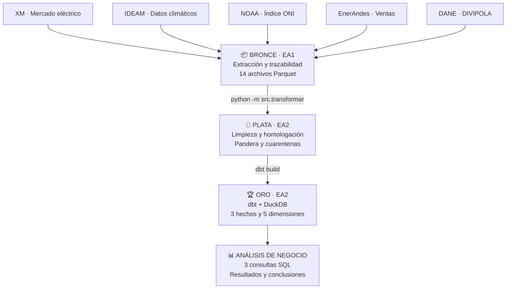
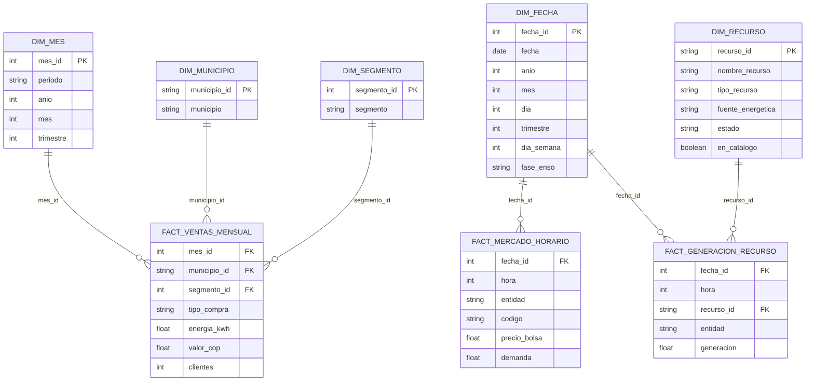
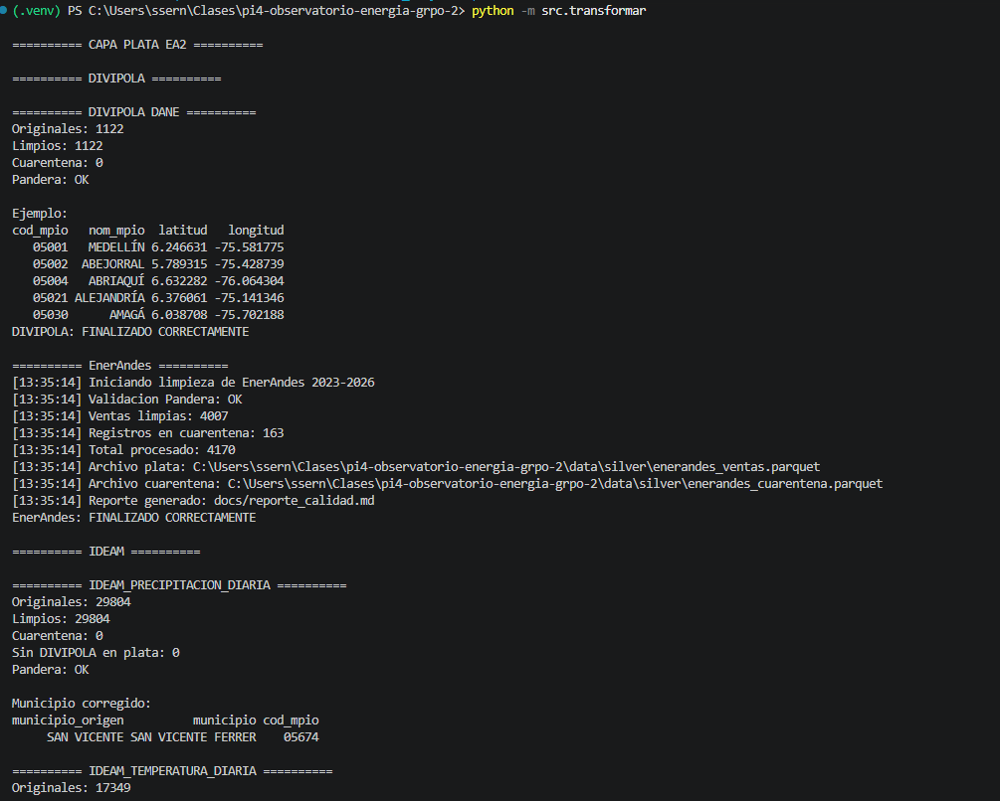
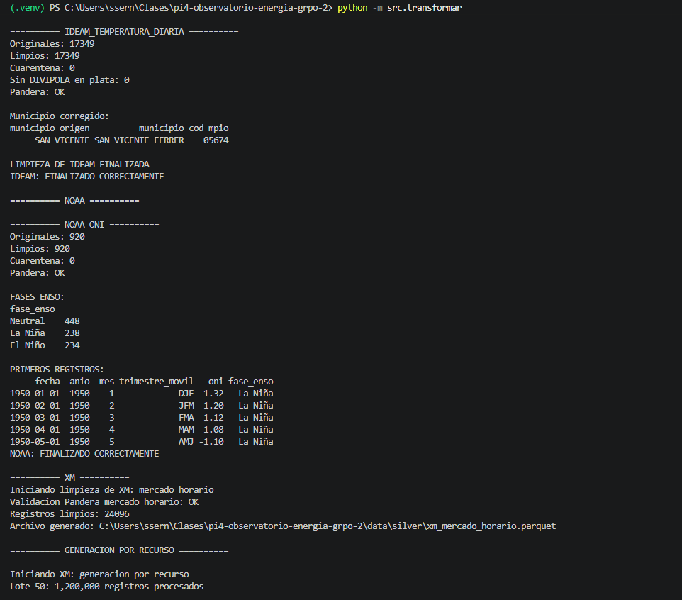
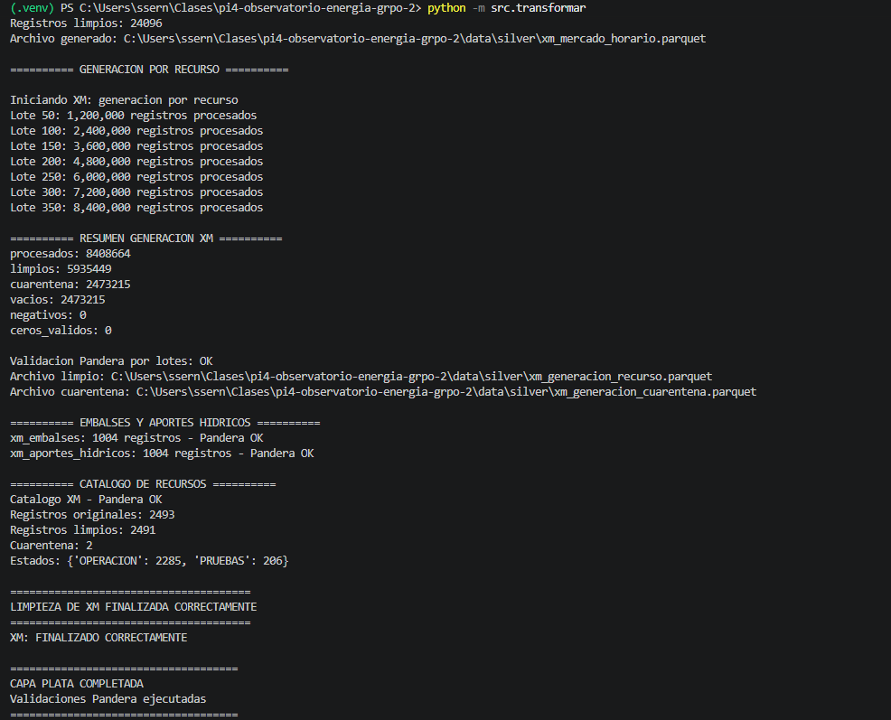
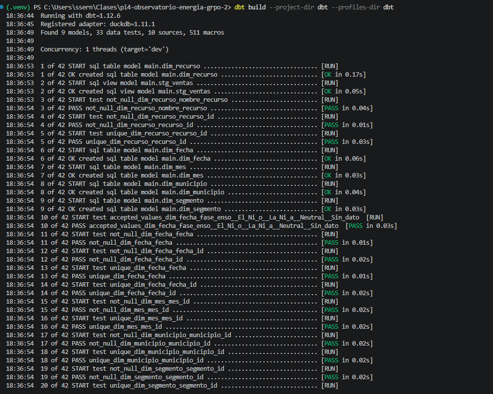
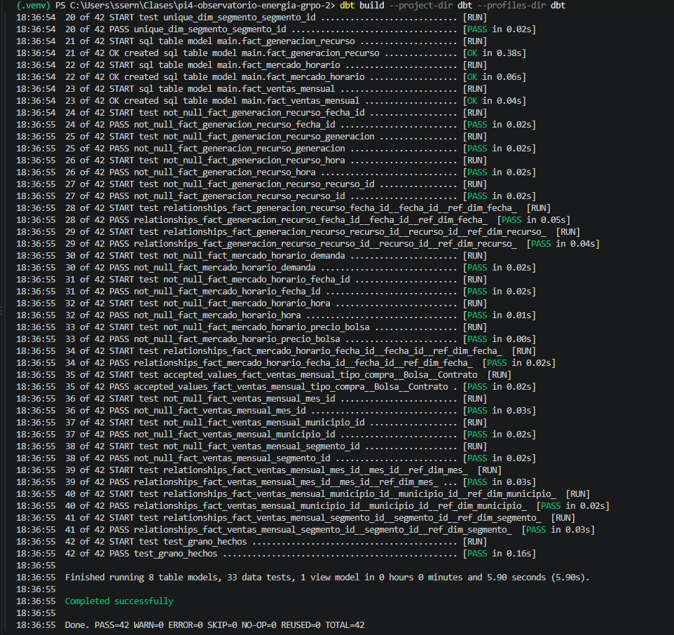

# Observatorio de Energía y Clima — Equipo 2
> **Proyecto Integrado IV · Integración de Información**  

> IU Digital de Antioquia | Periodo académico 2026-2

**Proyecto de integración, calidad y análisis de datos energéticos y climáticos de Colombia.**

| Entregable          | Alcance                                                  | Resultado documentado                               |
| :------------------ | :------------------------------------------------------- | :-------------------------------------------------- |
| 📦 **EA1 · Bronce** | Extracción y perfilamiento de cinco fuentes              | 14 archivos Parquet y evidencias de ejecución       |
| 🧹 **EA2 · Plata**  | Limpieza, homologación, cuarentenas y validación Pandera | 10 conjuntos limpios; ejecución integral verificada |
| 🏆 **EA2 · Oro**    | Modelo dimensional con dbt y DuckDB                      | 8 tablas, 1 vista y **33 pruebas aprobadas**        |
| 📈 **Análisis**     | Tres consultas SQL y respuestas de negocio               | Resultados y capturas documentados                  |

## 👥 Integrantes y responsabilidades
| Integrante             | GitHub                                                 | Responsabilidades                             |
| :--------------------- | :----------------------------------------------------- | :-------------------------------------------- |
| Sol Elena Serna Vargas | [@SernaSol](https://github.com/SernaSol)               | Ingeniería de datos, arquitectura y analítica |
| Esteban Urrutia        | [@estebanurrutia1](https://github.com/estebanurrutia1) | Calidad de datos, modelado BI y presentación  |

## 🎯 Objetivo del proyecto y pregunta de negocio
Construir un **Observatorio de Energía y Clima** que integre información del mercado eléctrico colombiano (**XM**), condiciones climáticas (**IDEAM y NOAA**), ventas de **EnerAndes** y datos territoriales oficiales del **DANE / DIVIPOLA**, para disponer de información confiable y facilitar el análisis del sector energético.

El proyecto se desarrolla de forma progresiva en dos entregas:

- **📦 EA1 — Extracción y capa bronce:** obtener datos reales de las cinco fuentes, preservar su estructura original y trazabilidad, generar muestras y documentar la calidad inicial mediante perfilamiento.

- **🧹 EA2 — Calidad, capa plata y capa oro:** limpiar y homologar los datos, validar sus reglas con Pandera, conservar registros en cuarentena y construir con dbt y DuckDB un modelo dimensional de **3 tablas de hechos y 5 dimensiones**, sobre el que se ejecutan consultas SQL de negocio.

**Pregunta general de negocio:**

> ¿Qué relación existe entre las precipitaciones registradas en Antioquia, los niveles de los embalses y los precios de la energía eléctrica en Colombia durante 2025 y 2026?

**Análisis desarrollados en EA2:** comparar precio y demanda por fase ENSO, identificar las fuentes de mayor generación eléctrica y analizar las ventas de EnerAndes por municipio y segmento. Estos análisis son **descriptivos**: apoyan la toma de decisiones, pero no establecen causalidad ni resuelven por sí solos toda la pregunta general.

## 🏗️ Arquitectura general del proyecto
El Observatorio de Energía y Clima implementa una arquitectura de datos de tres capas: **bronce, plata y oro**, desarrolladas durante las entregas EA1 y EA2.

### 🔄 Flujo del pipeline

### 📋 Descripción de las capas
| Capa | Entrega | Función principal |
|---|---|---|
| 📦 **Bronce** | EA1 | Extraer y conservar los datos originales con trazabilidad. |
| 🧹 **Plata** | EA2 | Limpiar, estandarizar y validar con Pandera, separando registros inválidos en cuarentena. |
| 🏆 **Oro** | EA2 | Construir el modelo dimensional con dbt y DuckDB para el análisis de negocio. |

Los archivos originales permanecen en bronce sin modificaciones. La capa plata contiene los datos validados y la capa oro organiza la información en tablas de hechos y dimensiones.

Las instrucciones para reconstruir cada capa se encuentran en la sección **✅ Reproducibilidad y pruebas de EA2**.

---
## 📘 ENTREGA 1 — Capa bronce (EA1)
### 📦 1. Fuentes de datos y extracción
La extracción integra **cinco fuentes** y, en la ejecución documentada, produce **14 archivos Parquet** en `data/bronze/`.

| Fuente          | Acceso                                 | Archivos en `data/bronze/`                                                                                            |
| :-------------- | :------------------------------------- | :-------------------------------------------------------------------------------------------------------------------- |
| XM – Sinergox   | API REST / JSON                        | `xm_precio_bolsa`, `xm_demanda`, `xm_embalses`, `xm_generacion_recurso`, `xm_aportes_hidricos`, `xm_listado_recursos` |
| IDEAM           | API Socrata / consultas SoQL           | `ideam_precipitacion_diaria`, `ideam_temperatura_diaria`                                                              |
| NOAA            | Archivo del índice ONI                 | `noaa_oni`                                                                                                            |
| EnerAndes       | Excel 2023-2026 suministrado al equipo | `enerandes_ventas_2023`, `enerandes_ventas_2024`, `enerandes_ventas_2025`, `enerandes_ventas_2026`                    |
| DANE / DIVIPOLA | API de datos abiertos                  | `dane_divipola`                                                                                                       |

Los nombres anteriores corresponden a archivos con extensión `.parquet`.

- **XM:** extracción configurada del 1 de enero de 2024 al 30 de septiembre de 2026, usando ventanas cuando corresponde. El listado de recursos es un catálogo, no una serie histórica.

- **IDEAM:** consulta de precipitación diaria (suma) y temperatura diaria (promedio, mínimo y máximo) en Antioquia, desde el 1 de enero de 2025 hasta el 30 de septiembre de 2026. En la extracción documentada, la última fecha disponible fue el 24 de julio de 2026.

- **NOAA:** índice ONI de [Climate Prediction Center](https://www.cpc.ncep.noaa.gov/data/indices/oni.ascii.txt).

- **EnerAndes:** libro `data/insumos/ventas_enerandes_2023_2026.xlsx`, con hojas heterogéneas para 2023-2026.

- **DANE:** DIVIPOLA obtenido de [Datos Abiertos Colombia](https://www.datos.gov.co/resource/gdxc-w37w.json), para los códigos y nombres oficiales de municipios.

Los archivos originales se mantienen en bronce y conservan las columnas de trazabilidad `_fuente`, `_origen` y `_extraido_en`.

### ⚙️ 2. Instalación y ejecución de bronce
```powershell
git clone https://github.com/SernaSol/pi4-observatorio-energia-grpo-2.git

cd pi4-observatorio-energia-grpo-2

python -m venv .venv

.\.venv\Scripts\Activate.ps1

python -m pip install -r requirements.txt
```
El archivo `requirements.txt` incluye, entre otras dependencias, pandas, PyArrow, Pandera, pytest, DuckDB y `dbt-duckdb`.

**Insumo local:** ubicar el libro de Excel de EnerAndes en `data/insumos/ventas_enerandes_2023_2026.xlsx`. Sin este archivo no se puede garantizar una extracción completa desde una clonación limpia.

```powershell
New-Item -ItemType Directory -Force data/insumos
```
```powershell
python -m src.pipeline
```
Este comando ejecuta los cinco extractores, genera los archivos en `data/bronze/` y omite las descargas cuyos archivos ya existen. Para forzar nuevas consultas:

```powershell
python -m src.pipeline --forzar
```
**Actividades complementarias de EA1:**

```powershell
python -m src.generar_muestras

python -m src.perfilar_datos
```
Las muestras se guardan en `data/sample/`. El perfilamiento genera `docs/perfilamiento.md`; **volver a ejecutarlo sobrescribe ese informe**, así que se deben conservar previamente los ajustes manuales.

### 📊 3. Perfilamiento y calidad inicial
El perfilamiento de la capa bronce se obtiene mediante:

```powershell
python -m src.perfilar_datos
```
El resultado se documenta en [`docs/perfilamiento.md`](docs/perfilamiento.md), con registros, columnas, valores nulos, duplicados y cobertura temporal. Entre los hallazgos de **EA1** se registraron:

| Hallazgo en bronce                  | Evidencia                                | Observación                                                          |
| :---------------------------------- | :--------------------------------------- | :------------------------------------------------------------------- |
| Posibles duplicados en EnerAndes    | 120 filas en los archivos de 2023 a 2026 | Requerían validación durante la limpieza de EA2                      |
| Valores nulos en EnerAndes          | Hasta el 1,44 % en `col_2` de 2023       | Se necesitaba interpretar el encabezado antes de clasificar el error |
| Diferencias de estructura del Excel | 2024: 11 columnas; otros años: 10        | Exigían homologación en plata                                        |
| Cobertura IDEAM                     | Última fecha publicada: 24-07-2026       | Anterior al final solicitado: 30-09-2026                             |
| Duplicados exactos en catálogo XM   | 2 filas entre 2.493 registros            | Debían revisarse antes de cargar dimensiones                         |

Estos hallazgos corresponden al **perfilamiento inicial de bronce**, no a los conteos de datos limpios de EA2. Volver a ejecutar el script puede sobrescribir `docs/perfilamiento.md`; conviene conservar cualquier edición manual previamente.

### 🧪 4. Pruebas automáticas de EA1
Para ejecutar las pruebas automáticas del proyecto:

```powershell
python -m pytest -v
```
La captura conservada de **EA1** muestra **4 pruebas aprobadas** durante esa entrega. En **EA2** se amplió la batería de pruebas; sus resultados se presentan en la sección de reproducibilidad de la segunda entrega.

### 📸 5. Evidencias de ejecución de EA1
Estas **cinco capturas pertenecen al primer entregable** y no deben confundirse con la ejecución de pruebas de EA2.

**1. Pipeline de extracción**


**2. Pruebas de Python de EA1**


**3. Muestras CSV**


**4. Perfilamiento de bronce**


**5. Fuente DIVIPOLA**


---
## 📗 ENTREGA 2 — Capas plata y oro (EA2)
### 🧹 1. Transformación y limpieza con Pandera
```powershell
python -m src.transformar
```
`src/transformar.py` coordina las cinco limpiezas en este orden: **DIVIPOLA → EnerAndes → IDEAM → NOAA → XM**. Comprueba los 14 insumos bronce, valida con Pandera y guarda los resultados en `data/silver/` junto con los registros en cuarentena.

> **Dependencia importante:** DIVIPOLA debe ejecutarse antes de IDEAM para realizar la homologación de municipios. XM procesa millones de valores horarios por lotes y puede requerir más recursos.

**Ejecución final verificada:**

```text
DIVIPOLA: FINALIZADO CORRECTAMENTE

EnerAndes: FINALIZADO CORRECTAMENTE

IDEAM: FINALIZADO CORRECTAMENTE

NOAA: FINALIZADO CORRECTAMENTE

XM: FINALIZADO CORRECTAMENTE

CAPA PLATA COMPLETADA

Validaciones Pandera ejecutadas
```
También es posible ejecutar cada transformación individualmente desde `src/silver/`, pero **`python -m src.transformar` es el comando único recomendado para reproducir toda la capa plata**.

### 📊 2. Resultados y reportes de calidad
Las reglas de calidad se aplican a los datos transformados con **Pandera**. Los registros rechazados se guardan en cuarentena sin alterar los archivos originales de bronce.

| Tabla limpia                           | Registros válidos | En cuarentena |
| :------------------------------------- | ----------------: | ------------: |
| EnerAndes: ventas consolidadas         |             4.007 |           163 |
| XM: mercado horario (precio y demanda) |            24.096 |             0 |
| XM: generación por recurso             |         5.935.449 |     2.473.215 |
| XM: embalses                           |             1.004 |             0 |
| XM: aportes hídricos                   |             1.004 |             0 |
| XM: catálogo de recursos               |             2.491 |             2 |
| IDEAM: precipitación                   |            29.804 |             0 |
| IDEAM: temperatura                     |            17.349 |             0 |
| NOAA: ONI                              |               920 |             0 |
| DANE: DIVIPOLA                         |             1.122 |             0 |
| **Total de las 10 tablas**             |     **6.017.246** | **2.473.380** |

Las cifras se refieren a filas de tablas con **granularidades diferentes**; por eso, los totales son un inventario de registros y no una medida energética agregable. Las cuarentenas se conservan para auditoría. El detalle de reglas y motivos está en [`docs/reporte_calidad.md`](docs/reporte_calidad.md), [`docs/reporte_calidad_enerandes.md`](docs/reporte_calidad_enerandes.md) y [`docs/reporte_calidad_xm_generacion.md`](docs/reporte_calidad_xm_generacion.md).

### 🏗️ 3. Modelo dimensional con dbt y DuckDB
El modelo implementa una **constelación de estrellas**: tres tablas de hechos y cinco dimensiones relacionadas directamente mediante claves.

| Tipo      | Modelo                    | Grano                                       |
| :-------- | :------------------------ | :------------------------------------------ |
| Hecho     | `fact_ventas_mensual`     | Mes + municipio + segmento + tipo de compra |
| Hecho     | `fact_mercado_horario`    | Fecha + hora + entidad + código             |
| Hecho     | `fact_generacion_recurso` | Fecha + hora + recurso                      |
| Dimensión | `dim_mes`                 | Mes                                         |
| Dimensión | `dim_municipio`           | Municipio                                   |
| Dimensión | `dim_segmento`            | Segmento comercial                          |
| Dimensión | `dim_fecha`               | Día, con fase ENSO                          |
| Dimensión | `dim_recurso`             | Recurso de generación                       |

#### 🔗 Diagrama entidad-relación del modelo dimensional
El siguiente diagrama muestra las relaciones entre las **tres tablas de hechos** y las **cinco dimensiones** de la capa oro. Se mantiene el mismo modelo documentado en [`docs/modelo_dimensional.md`](docs/modelo_dimensional.md).


Los **10 códigos históricos** de generación ausentes en el catálogo XM se incluyen en `dim_recurso` con `en_catalogo = false`, sin inventar sus atributos y sin perder las 22.003 observaciones horarias asociadas.

Documentación: [`docs/modelo_dimensional.md`](docs/modelo_dimensional.md) y [`docs/diccionario_datos.md`](docs/diccionario_datos.md). La conexión de dbt se encuentra en `dbt/profiles.yml` y utiliza `data/observatorio.duckdb`.

### 📈 4. Consultas SQL y respuestas de negocio
Se ejecutaron las tres consultas SQL de la carpeta [`consultas/oro/`](consultas/oro/) sobre la **capa oro**, y las capturas originales se guardaron en `docs/evidencias_consultas/`.

#### 🌊 Consulta 1. ¿Cómo varían el precio de bolsa y la demanda según la fase ENSO?
**Archivo:** [`01_precio_demanda_enso.sql`](consultas/oro/01_precio_demanda_enso.sql).

**Resultados completos** (las cinco combinaciones de año y fase registradas):

| Año  | Fase ENSO | Registros horarios | Precio de bolsa promedio | Demanda promedio |
| :--- | :-------- | -----------------: | -----------------------: | ---------------: |
| 2025 | La Niña   |              2.208 |                   222,83 |     9.650.512,14 |
| 2025 | Neutral   |              6.552 |                   246,14 |     9.460.926,48 |
| 2026 | El Niño   |              2.952 |                   697,38 |    10.154.755,71 |
| 2026 | Neutral   |              2.880 |                   208,03 |     9.744.750,60 |
| 2026 | Sin dato  |                720 |                   676,95 |    10.373.311,88 |


**Respuesta de negocio:** durante 2025, el precio medio de bolsa asociado con La Niña (222,83) fue menor que durante la fase Neutral (246,14). Durante 2026, El Niño presentó un precio medio de 697,38, frente a 208,03 en fase Neutral. La observación es descriptiva y **no implica causalidad**; las fases cubren intervalos diferentes del tiempo. La categoría `Sin dato` corresponde a fechas sin emparejamiento disponible con ONI.

#### ⚡ Consulta 2. ¿Qué fuentes energéticas aportaron más generación en 2025 y 2026?
**Archivo:** [`02_generacion_por_fuente.sql`](consultas/oro/02_generacion_por_fuente.sql).

**Resultados completos de la captura de consola**. Los importes de la generación con notación `e+` reflejan la precisión visualizada en la terminal; los tres primeros de cada año se muestran con decimales exactos a partir de la salida adicional de verificación.

| Año  | Fuente energética           | Recursos | Registros horarios | Generación total reportada |
| :--- | :-------------------------- | -------: | -----------------: | -------------------------: |
| 2025 | AGUA                        |      153 |          1.090.401 |          68.099.361.311,66 |
| 2025 | GAS                         |       37 |            147.759 |           6.516.305.547,21 |
| 2025 | RAD SOLAR                   |      214 |            637.571 |           4.473.803.713,71 |
| 2025 | CARBON                      |       18 |             50.062 |               3,564212e+09 |
| 2025 | BAGAZO                      |       14 |             99.584 |               8,852053e+08 |
| 2025 | COMBUSTOLEO                 |        2 |              8.761 |               5,454459e+08 |
| 2025 | VIENTO                      |        3 |             19.259 |               1,548648e+08 |
| 2025 | ACPM                        |        3 |                595 |               7,822166e+07 |
| 2025 | BIOMASA                     |        2 |              8.435 |               4,001184e+07 |
| 2025 | BIOGAS                      |        5 |             24.504 |               2,522028e+07 |
| 2025 | Sin informacion en catalogo |        6 |              8.403 |               2,255643e+07 |
| 2025 | GLP                         |        1 |                151 |               5,851272e+06 |
| 2025 | JET-A1                      |        1 |                 67 |               8,180189e+05 |
| 2026 | AGUA                        |      153 |            802.259 |          47.528.319.551,89 |
| 2026 | GAS                         |       36 |            100.799 |           6.700.792.138,77 |
| 2026 | CARBON                      |       18 |             64.615 |           5.420.085.865,57 |
| 2026 | RAD SOLAR                   |      372 |            883.947 |               5,229448e+09 |
| 2026 | BAGAZO                      |       14 |             71.676 |               6,855717e+08 |
| 2026 | COMBUSTOLEO                 |        3 |              7.467 |               4,277581e+08 |
| 2026 | ACPM                        |        3 |              1.524 |               2,432397e+08 |
| 2026 | VIENTO                      |        3 |             16.560 |               1,552257e+08 |
| 2026 | BIOMASA                     |        2 |              8.806 |               6,873335e+07 |
| 2026 | JET-A1                      |        1 |                592 |               2,125990e+07 |
| 2026 | BIOGAS                      |        6 |             18.806 |               1,524568e+07 |
| 2026 | Sin informacion en catalogo |        1 |              1.253 |               4,505280e+06 |


**Respuesta de negocio:** AGUA ocupa la primera posición en ambos años; en 2025 la siguen GAS y RAD SOLAR, y en 2026 GAS y CARBON. Esto evidencia el peso de la generación asociada al recurso hídrico en el conjunto analizado. La unidad física exacta de `generacion` debe comprobarse contra los metadatos de XM antes de expresar sumas en MWh o GWh. El catálogo no cubre todos los recursos históricos, de ahí la categoría sin información.

#### 🏙️ Consulta 3. ¿Qué municipios y segmentos concentran las mayores ventas de EnerAndes?
**Archivo:** [`03_ventas_municipio_segmento.sql`](consultas/oro/03_ventas_municipio_segmento.sql).

**Resultados completos:** 10 primeras combinaciones de municipio y segmento por año. Los valores `e+` de facturación conservan el redondeo de la captura de consola; las tres primeras filas por año se recuperaron con mayor precisión de la salida de verificación.

| Año  | Posición | Municipio | Segmento    | Meses registrados | Energía vendida (kWh) | Valor facturado (COP) |
| :--- | -------: | :-------- | :---------- | ----------------: | --------------------: | --------------------: |
| 2025 |        1 | Medellín  | Residencial |                12 |           147.618.494 |       153.013.703.375 |
| 2025 |        2 | Medellín  | Industrial  |                12 |           112.373.719 |       109.670.830.517 |
| 2025 |        3 | Medellín  | Comercial   |                12 |            81.639.018 |        97.802.299.184 |
| 2025 |        4 | Bello     | Residencial |                12 |            38.395.670 |          3,972255e+10 |
| 2025 |        5 | Bello     | Industrial  |                12 |            29.123.201 |          2,785583e+10 |
| 2025 |        6 | Itagüí    | Residencial |                12 |            28.262.920 |          2,930448e+10 |
| 2025 |        7 | Envigado  | Residencial |                12 |            25.231.477 |          2,610400e+10 |
| 2025 |        8 | Itagüí    | Industrial  |                12 |            20.999.048 |          2,044197e+10 |
| 2025 |        9 | Bello     | Comercial   |                12 |            19.568.466 |          2,349608e+10 |
| 2025 |       10 | Envigado  | Industrial  |                12 |            18.555.979 |          1,810089e+10 |
| 2026 |        1 | Medellín  | Residencial |                 9 |           115.719.258 |       129.581.551.324 |
| 2026 |        2 | Medellín  | Industrial  |                 9 |            85.994.552 |        90.310.434.199 |
| 2026 |        3 | Medellín  | Comercial   |                 9 |            62.601.897 |        80.893.758.461 |
| 2026 |        4 | Bello     | Residencial |                 9 |            28.347.519 |          3,191784e+10 |
| 2026 |        5 | Bello     | Industrial  |                 9 |            22.130.831 |          2,337150e+10 |
| 2026 |        6 | Itagüí    | Residencial |                 9 |            22.099.469 |          2,474863e+10 |
| 2026 |        7 | Envigado  | Residencial |                 9 |            19.583.833 |          2,196659e+10 |
| 2026 |        8 | Itagüí    | Industrial  |                 9 |            16.416.485 |          1,721054e+10 |
| 2026 |        9 | Bello     | Comercial   |                 9 |            15.752.445 |          2,038925e+10 |
| 2026 |       10 | Rionegro  | Residencial |                 9 |            14.024.237 |          1,569117e+10 |


**Respuesta de negocio:** Medellín aparece en las tres primeras posiciones de los dos años, con el segmento residencial a la cabeza, seguido por el industrial y el comercial. El análisis permite priorizar segmentos y municipios para seguimiento de ventas. **No debe concluirse que las ventas disminuyeron en 2026:** la consulta compara 12 meses de 2025 frente a solo 9 meses de 2026.

#### 🔎 Consideraciones para interpretar los resultados
1\. Las comparaciones de totales de 2025 y 2026 deben ajustarse por los meses realmente observados.

2\. La clasificación ENSO proviene del ONI de NOAA asignado al mes central de cada trimestre móvil.

3\. `Sin dato` (ENSO) y `Sin informacion en catalogo` (XM) indican faltantes documentados, no valores inventados.

4\. Los resultados no prueban relaciones de causa y efecto.

5\. Para las magnitudes de XM se conservan los valores de origen; confirmar la unidad en los metadatos del indicador.

### 📸 5. Evidencias de ejecución de EA2
Las siguientes capturas muestran la ejecución completa de las

capas plata y oro, junto con sus validaciones de calidad.

#### 🥈 1. Ejecución y validación de la capa plata
**Comando ejecutado:** `python -m src.transformar`

**Captura 1.** Inicio de la transformación: limpieza de DIVIPOLA,

consolidación de ventas EnerAndes y procesamiento de precipitación IDEAM.



**Captura 2.** Finalización de IDEAM, validación del índice ONI de NOAA

e inicio de la transformación de los datos horarios de XM.



**Captura 3.** Procesamiento por lotes de generación XM, separación de

registros en cuarentena, validación de embalses, aportes hídricos y

catálogo de recursos.



**Resultado:** Las cinco fuentes finalizaron correctamente.

Se generaron los archivos de la capa plata y se ejecutaron

las validaciones de Pandera.

`CAPA PLATA COMPLETADA — Validaciones Pandera ejecutadas`

#### 🥇 2. Construcción y validación de la capa oro
**Comando ejecutado:** `dbt build --project-dir dbt --profiles-dir dbt`

**Captura 1.** Inicio de dbt, construcción de las dimensiones,

creación de la vista staging y ejecución de las primeras pruebas.



**Captura 2.** Construcción de las tablas de hechos, comprobación

de relaciones, unicidad, valores obligatorios y granularidad.



**Resultado:** Se construyeron 8 tablas y 1 vista, y se aprobaron

las 33 pruebas de datos de dbt.

**Resultado final:** `PASS=42 WARN=0 ERROR=0`

### ✅ 6. Reproducibilidad y pruebas de EA2
**Orden recomendado desde la raíz del repositorio** (con el entorno virtual activo y los insumos disponibles):

```powershell
# 1. Obtener la capa bronce, si aún no está disponible

python -m src.pipeline

# 2. Reconstruir la capa plata con todas sus validaciones

python -m src.transformar

# 3. Ejecutar las pruebas automáticas de Python

python -m pytest -v

# 4. Reconstruir la capa oro y validar el modelo

dbt build --project-dir dbt --profiles-dir dbt
```
La tercera y cuarta instrucciones son independientes: `pytest` valida el código Python y `dbt build` verifica los modelos y los datos de oro. Para el paso 4, primero deben existir los Parquet de plata.

#### 🏆 Resultado verificado de dbt
```powershell
dbt build --project-dir dbt --profiles-dir dbt
```
Este comando utiliza los Parquet de plata, materializa el modelo de DuckDB en `data/observatorio.duckdb` y valida su calidad y relaciones mediante dbt.

**Resultado final verificado en consola:**

```text
Finished running 8 table models, 33 data tests, 1 view model

Completed successfully

Done. PASS=42 WARN=0 ERROR=0 SKIP=0 NO-OP=0 REUSED=0 TOTAL=42
```
| Verificación dbt                            | Cantidad |       Estado      |
| :------------------------------------------ | -------: | :---------------: |
| Tablas materializadas                       |        8 |         ✅         |
| Vista staging                               |        1 |         ✅         |
| Pruebas de datos (incluida la granularidad) |       33 |         ✅         |
| **Total de ejecuciones**                    |   **42** | **✅ Sin errores** |

#### 🧪 Pruebas Python de EA2
```powershell
python -m pytest -v
```
**Última ejecución documentada de EA2:** 26 pruebas aprobadas. Estas son pruebas de Python y son independientes de las 33 pruebas de datos de dbt. Las cuatro pruebas mostradas en la evidencia de EA1 pertenecen a una ejecución anterior.

#### 🔍 Reproducir las tres consultas SQL
Tras finalizar `dbt build`, ejecutar desde PowerShell las tres consultas SQL guardadas en `consultas/oro/`:

```powershell
@'

import duckdb

from pathlib import Path

con = duckdb.connect('data/observatorio.duckdb', read_only=True)

for ruta in sorted(Path('consultas/oro').glob('*.sql')):

    print('\n===', ruta.name, '===')

    print(con.execute(ruta.read_text(encoding='utf-8')).df().to_string(index=False))

con.close()

'@ | python -
```
**Alcance de la verificación:** la ejecución se realizó con los archivos bronce existentes localmente. Para comprobar una reproducción íntegra desde un clon limpio también debe disponerse del Excel de EnerAndes y acceso a las fuentes externas.

---
## 🤝 INFORMACIÓN COMPLEMENTARIA

### 🗂️ 1. Organización del repositorio

El proyecto está organizado por capas de procesamiento y componentes
funcionales, separando la extracción de datos (EA1), la transformación
y validación (EA2), el modelado dimensional y las consultas analíticas.

```text
pi4-observatorio-energia-grpo-2/
│
├── consultas/
│   ├── 01_precio_vs_embalses.sql
│   ├── 02_precio_por_hora.sql
│   └── oro/
│       ├── 01_precio_demanda_enso.sql
│       ├── 02_generacion_por_fuente.sql
│       └── 03_ventas_municipio_segmento.sql
│
├── data/
│   ├── bronze/                  # Datos originales - EA1
│   ├── silver/                  # Datos limpios y cuarentenas - EA2
│   ├── insumos/                 # Excel de EnerAndes
│   ├── sample/                  # 14 muestras CSV
│   └── observatorio.duckdb      # Base de datos oro generada con dbt
│
├── dbt/
│   ├── models/
│   │   ├── staging/
│   │   │   ├── sources.yml
│   │   │   └── stg_ventas.sql
│   │   └── marts/
│   │       ├── dim_fecha.sql
│   │       ├── dim_mes.sql
│   │       ├── dim_municipio.sql
│   │       ├── dim_segmento.sql
│   │       ├── dim_recurso.sql
│   │       ├── fact_ventas_mensual.sql
│   │       ├── fact_mercado_horario.sql
│   │       ├── fact_generacion_recurso.sql
│   │       └── schema.yml
│   ├── tests/
│   │   └── test_grano_hechos.sql
│   ├── dbt_project.yml
│   └── profiles.yml
│
├── docs/
│   ├── bitacoras/
│   │   ├── serna_sol.md
│   │   └── urrutia_juan_esteban.md
│   │
│   ├── evidencias/
│   │   ├── pipeline.png             
│   │   ├── pytest.png               
│   │   ├── muestras.png             
│   │   ├── perfilamiento.png        
│   │   ├── divipola.png             
│   │   ├── ea2_plata_1.png          # EA2 - Transformación
│   │   ├── ea2_plata_2.png          # EA2 - Validaciones
│   │   ├── ea2_plata_3.png          # EA2 - Resultado final
│   │   ├── ea2_dbt_1.png            # EA2 - Construcción oro
│   │   └── ea2_dbt_2.png            # EA2 - Pruebas dbt
│   │
│   ├── evidencias_consultas/
│   │   ├── consulta_01_enso.png
│   │   ├── consulta_02_generacion.png
│   │   └── consulta_03_ventas.png
│   │
│   ├── perfilamiento.md
│   ├── reporte_calidad.md
│   ├── reporte_calidad_enerandes.md
│   ├── reporte_calidad_xm_generacion.md
│   ├── modelo_dimensional.md
│   └── diccionario_datos.md
│
├── src/
│   ├── extract/                 # Extracción de las cinco fuentes
│   ├── silver/                  # Transformaciones por fuente
│   ├── quality/
│   │   └── esquemas.py          # Validaciones Pandera
│   ├── config.py
│   ├── pipeline.py              # Ejecución de bronce
│   ├── transformar.py           # Ejecución integral de plata
│   ├── generar_muestras.py
│   ├── perfilar_datos.py
│   ├── consultar.py
│   └── utils.py
│
├── tests/                       # Pruebas automáticas pytest
│
├── .gitignore
├── requirements.txt
└── README.md
```

**Consideraciones del versionamiento:**

- `data/bronze/` y `data/silver/` contienen archivos Parquet que se generan durante la ejecución y no se suben a GitHub.
- `data/observatorio.duckdb` se reconstruye mediante dbt y tampoco se versiona.
- `dbt/target/` y `dbt/logs/` contienen archivos temporales que están excluidos por `.gitignore`.
- Las consultas SQL, los modelos dbt, los scripts Python, las bitácoras y las evidencias deben conservarse en el repositorio.

**Comandos principales:**

- Capa bronce: `python -m src.pipeline`
- Capa plata: `python -m src.transformar`
- Capa oro: `dbt build --project-dir dbt --profiles-dir dbt`
- Pruebas Python: `python -m pytest -v`


---
### 👥 2. Trabajo colaborativo y videos
El equipo trabaja con Git y GitHub, ramas por funcionalidad, Pull Requests y bitácoras individuales en `docs/bitacoras/`.

| Integrante      | Video de presentación                     |
| :-------------- | :---------------------------------------- |
| Sol Serna       | [Ver video](https://youtu.be/bYMpWIKqmkc) |
| Esteban Urrutia | [Ver video](https://youtu.be/cPOe41iujWA) |

Se debe comprobar en GitHub el cumplimiento final de commits, revisiones, PR y etiqueta de entrega EA2. Los archivos grandes de datos plata, oro y la base DuckDB **no se incluyen en Git**.

### 🤖 3. Uso de inteligencia artificial y limitaciones
Se utilizó ChatGPT como apoyo para interpretar requisitos, revisar scripts, estructurar pruebas y redactar documentación técnica. Los resultados y cambios deben ser revisados, ejecutados y validados por los integrantes.

**Limitaciones conocidas:**

- La disponibilidad de datos del IDEAM depende de las publicaciones y filtros de sus fuentes.

- El Excel de EnerAndes debe estar accesible para reproducir la extracción completa.

- Las unidades de algunas métricas XM requieren validación en los metadatos originales.

- La dimensión recurso incluye códigos históricos sin descripción en el catálogo.

- Las relaciones entre precipitación, embalses y precios aún requieren análisis específicos para responder integralmente la pregunta general.

- Una ejecución con datos ya presentes no demuestra por sí sola la reproducción desde una clonación limpia.

### 📚 4. Documentación técnica
| Documento                                                                                                                                                                         | Contenido                                             |
| :-------------------------------------------------------------------------------------------------------------------------------------------------------------------------------- | :---------------------------------------------------- |
| [Perfilamiento de bronce](docs/perfilamiento.md)                             | Hallazgos y distribución de los 14 archivos de origen |
| [Reporte consolidado de calidad](docs/reporte_calidad.md)                    | Reglas y controles de EA2                             |
| [Reporte de calidad de EnerAndes](docs/reporte_calidad_enerandes.md)         | Ventas limpias y cuarentena                           |
| [Reporte de calidad de generación XM](docs/reporte_calidad_xm_generacion.md) | Procesamiento por lotes y motivos de cuarentena       |
| [Modelo dimensional](docs/modelo_dimensional.md)                             | Tablas, granularidades y diagrama de relaciones       |
| [Diccionario de datos](docs/diccionario_datos.md)                            | Columnas y descripciones de la capa oro               |
