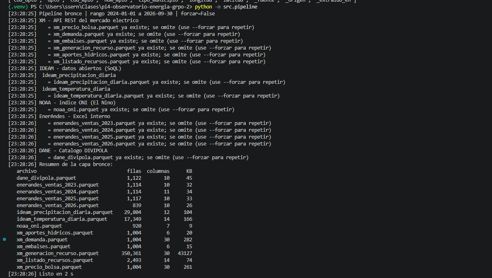
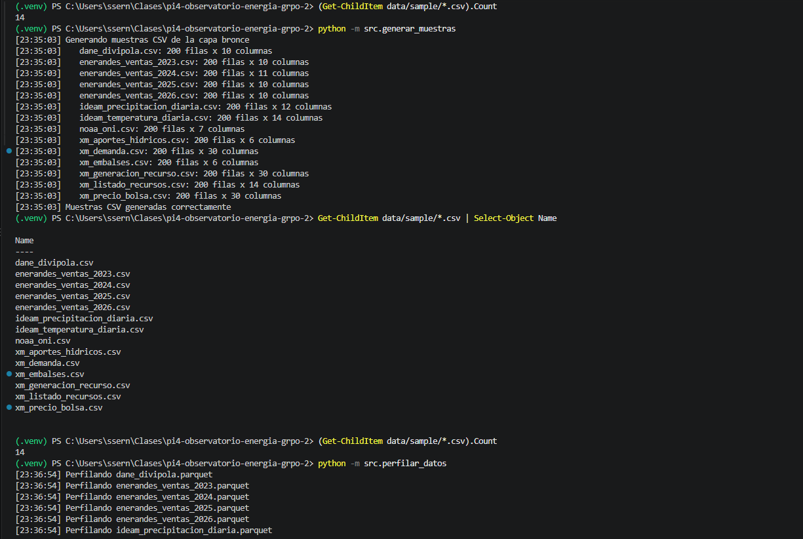
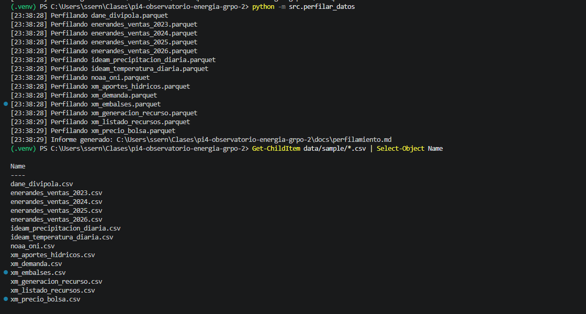
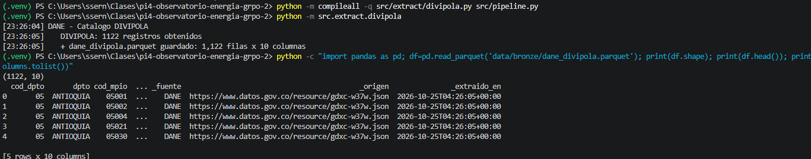

# Observatorio de Energía y Clima – Equipo 2

> Proyecto Integrado IV – Integración de Información | IU Digital de Antioquia | 2026-2

## 👥 Integrantes

| Nombre | Usuario GitHub | Rol |
|---|---|---|
| Sol Elena Serna Vargas | SernaSol| Líder técnico / Data Engineer |
| Esteban Urrutia | estebanurrutia1 | Data Quality Analyst |
| Sol Elena Serna Vargas | SernaSol| Analytics Engineer |
| Esteban Urrutia | estebanurrutia1 | BI Analyst / Storyteller |

## 🎯 Objetivo

Integrar datos del mercado eléctrico colombiano (XM), variables climáticas (IDEAM y NOAA), datos comerciales de EnerAndes e información territorial del DANE para facilitar el estudio de las relaciones entre el clima, los recursos hídricos y el comportamiento del sector energético.

### Pregunta de negocio

**¿Qué relación existe entre las precipitaciones registradas en Antioquia, los niveles de los embalses y los precios de la energía eléctrica en Colombia durante 2025 y 2026?**

DIVIPOLA sirve como referencia geográfica para identificar municipios y apoyar la vinculación de estaciones del IDEAM. Las correspondencias entre fuentes deberán validarse durante la transformación de datos; no se presume una unión ya construida.

## 📦 Fuentes de datos – capa bronce

El pipeline integra **cinco fuentes** y, en la ejecución validada, generó **14 archivos Parquet** en `data/bronze/`.

| Fuente | Acceso | Archivos de salida (`data/bronze/`) |
|---|---|---|
| XM – Sinergox | API REST / JSON | `xm_precio_bolsa.parquet`, `xm_demanda.parquet`, `xm_embalses.parquet`, `xm_generacion_recurso.parquet`, `xm_aportes_hidricos.parquet`, `xm_listado_recursos.parquet` |
| IDEAM – Datos Abiertos Colombia | API Socrata / consultas SoQL | `ideam_precipitacion_diaria.parquet`, `ideam_temperatura_diaria.parquet` |
| NOAA – índice ONI | Archivo de texto | `noaa_oni.parquet` |
| EnerAndes | Libro de Excel suministrado al equipo | `enerandes_ventas_2023.parquet`, `enerandes_ventas_2024.parquet`, `enerandes_ventas_2025.parquet`, `enerandes_ventas_2026.parquet` |
| DANE – DIVIPOLA | API REST / JSON | `dane_divipola.parquet` |

### XM – información energética

Se configuró la extracción histórica desde el **1 de enero de 2024 hasta el 30 de septiembre de 2026**, mediante consultas en ventanas de fechas cuando la métrica lo requiere. Incluye precio de bolsa, demanda real, porcentaje útil de embalses, generación por recurso, aportes hídricos y el catálogo de recursos. El catálogo `ListadoRecursos` no es una serie histórica y se obtiene mediante el servicio de listas.

### IDEAM – precipitación y temperatura

Se configuró una consulta para **Antioquia**, desde el **1 de enero de 2025 hasta el 30 de septiembre de 2026**. Los cálculos se realizan **en el servidor** mediante SoQL y por ventanas semanales:

- **Precipitación diaria:** suma de `valorobservado` por estación y fecha.
- **Temperatura diaria:** promedio, mínimo y máximo de `valorobservado` por estación y fecha.

**Limitación observada:** en los archivos descargados, la última fecha disponible fue el **24 de julio de 2026** para ambas variables. El período consultado no equivale a garantizar datos publicados hasta el 30 de septiembre.

### NOAA – índice ONI

Se conserva el contenido del archivo de texto del índice Oceanic Niño Index (ONI) en bronce, para apoyar el análisis de las condiciones climáticas asociadas con El Niño y La Niña.

**Origen:** https://www.cpc.ncep.noaa.gov/data/indices/oni.ascii.txt

### EnerAndes – ventas internas

Se procesan las hojas del libro `ventas_enerandes_2023_2026.xlsx`, conservando su estructura en archivos separados por año. La capa bronce no realiza la estandarización de encabezados, totales ni valores.

### DANE – DIVIPOLA (fuente adicional propia)

**Fuente:** Departamento Administrativo Nacional de Estadística (DANE), División Político-Administrativa de Colombia.

**Origen:** https://www.datos.gov.co/resource/gdxc-w37w.json

**Extractor:** `src/extract/divipola.py`

**Archivo de salida:** `data/bronze/dane_divipola.parquet`

Se consulta un catálogo de departamentos y municipios con códigos, nombres y coordenadas geográficas. La finalidad es complementar la información del IDEAM mediante una referencia territorial oficial. En la ejecución validada se obtuvieron **1.122 registros y 10 columnas**, incluidas tres columnas de trazabilidad agregadas por el pipeline.

## ⚙️ Requisitos previos

- Python 3.11 o una versión compatible con `requirements.txt`.
- `pip` y conexión a internet para consultar las fuentes públicas.
- Git para clonar el repositorio.
- Archivo `ventas_enerandes_2023_2026.xlsx` proporcionado por el equipo, cuando no esté disponible en el repositorio. **Sin este insumo no se puede garantizar una ejecución íntegra desde cero de la extracción de EnerAndes.**

Las instrucciones siguientes están dirigidas a **Windows PowerShell** y deben ejecutarse desde la raíz del repositorio.

## 🚀 Instalación y ejecución desde cero

### 1. Clonar el proyecto

```powershell
git clone https://github.com/SernaSol/pi4-observatorio-energia-grpo-2.git
cd pi4-observatorio-energia-grpo-2
```

### 2. Crear y activar un entorno virtual

```powershell
python -m venv .venv
.\.venv\Scripts\Activate.ps1
```

### 3. Instalar las dependencias

```powershell
python -m pip install -r requirements.txt
```

### 4. Preparar el insumo local de EnerAndes

```powershell
New-Item -ItemType Directory -Force data/insumos
```

Copiar el libro proporcionado por el equipo a:

`data/insumos/ventas_enerandes_2023_2026.xlsx`

### 5. Ejecutar el pipeline de extracción

```powershell
python -m src.pipeline
```

El pipeline llama a los extractores de **XM, IDEAM, NOAA, EnerAndes y DIVIPOLA**, y almacena los resultados en `data/bronze/`. Si un archivo ya existe, se omite su descarga.

Para forzar una nueva extracción de todas las fuentes:

```powershell
python -m src.pipeline --forzar
```

**Importante:** el tiempo de descarga depende de la conectividad, el volumen de las consultas y la disponibilidad de las APIs. Los rangos y parámetros están definidos en `src/config.py`.

### 6. Generar las muestras CSV

```powershell
python -m src.generar_muestras
```

Se genera un CSV por Parquet en `data/sample/`, con las **primeras 200 filas** de cada archivo (o menos si la fuente tiene menos registros). En la validación realizada se generaron **14 muestras de 200 filas**.

### 7. Ejecutar las pruebas automáticas

```powershell
python -m pytest -v
```

Se comprueban la división de ventanas de fechas, la detección de archivos ya descargados, el aplanamiento de respuestas JSON de XM y la construcción de consultas SoQL del IDEAM. La última ejecución documentada finalizó con **4 pruebas aprobadas**.

### 8. Generar el perfilamiento de bronce

```powershell
python -m src.perfilar_datos
```

Este script analiza los Parquet y escribe `docs/perfilamiento.md`, con cantidad de filas, columnas, tipos de dato, valores nulos, duplicados y rangos temporales. El informe revisado también incluye **cinco hallazgos de calidad con evidencia numérica**.

> **Atención:** volver a ejecutar `src.perfilar_datos` **sobrescribe** `docs/perfilamiento.md`. Si el informe incluye hallazgos y correcciones redactadas manualmente, se recomienda hacer una copia o conservar esos cambios mediante Git antes de regenerarlo.

## 🏗️ Arquitectura

```text
XM ────────────────┐
IDEAM ─────────────┤
NOAA ──────────────┤
EnerAndes ─────────┼──► BRONCE (Parquet + linaje)
DANE / DIVIPOLA ───┘            │
                                ├──► Muestras CSV (data/sample/)
                                └──► Perfilamiento (docs/perfilamiento.md)

Etapas posteriores previstas:
BRONCE ──► PLATA (limpieza y estandarización)
       ──► ORO (modelo analítico) ──► Dashboard
```

Cada archivo bronce incorpora las columnas de trazabilidad `_fuente`, `_origen` y `_extraido_en`.

## 📁 Estructura del repositorio

```text
pi4-observatorio-energia-grpo-2/
├── data/
│   ├── bronze/                     # Parquet generados; excluidos de Git
│   ├── insumos/                     # Insumos locales, incluido el Excel de EnerAndes
│   └── sample/                      # 14 muestras CSV publicables
├── docs/
│   ├── bitacoras/
│   │   ├── serna_sol.md
│   │   └── urrutia_juan_esteban.md
│   ├── capturas/
│   │   ├── pipeline.png
│   │   ├── pytest.png
│   │   ├── muestras.png
│   │   ├── perfilamiento.png
│   │   └── divipola.png
│   └── perfilamiento.md
├── src/
│   ├── extract/
│   │   ├── xm.py
│   │   ├── ideam.py
│   │   ├── noaa.py
│   │   ├── enerandes.py
│   │   └── divipola.py
│   ├── config.py
│   ├── pipeline.py
│   ├── generar_muestras.py
│   └── perfilar_datos.py
├── tests/
│   ├── test_utils.py
│   ├── test_xm.py
│   └── test_ideam.py
├── .gitignore
├── requirements.txt
└── README.md
```

La estructura corresponde a los componentes desarrollados y a las carpetas de evidencia que deben incluirse en la entrega.

## 📊 Calidad de datos: resultados destacados

El detalle por columna se encuentra en [`docs/perfilamiento.md`](docs/perfilamiento.md). Entre las observaciones del conjunto de datos descargado están:

| Hallazgo | Evidencia numérica | Consideración |
|---|---|---|
| Filas duplicadas en EnerAndes | 120 en total entre 2023 y 2026 | Verificar si son ventas repetidas, títulos o totales del Excel |
| Valores nulos en EnerAndes | Hasta 1,44 % en `col_2` de 2023 | Interpretar columnas antes de clasificarlo como error |
| Estructuras heterogéneas | 2024: 11 columnas; 2023, 2025 y 2026: 10 | Estandarizar en una etapa posterior |
| Cobertura de IDEAM | Última fecha observada: 2026-07-24 | No coincide con el fin del período solicitado (2026-09-30) |
| Catálogo XM | 2 filas duplicadas exactas en 2.493 registros | Revisar los registros antes de generar relaciones |

Las observaciones de perfilamiento son **alertas de calidad**, no pruebas definitivas de errores en los sistemas de origen. Los Parquet originales se mantienen sin alteraciones.

## 📸 Evidencias de ejecución en consola

Las imágenes deben guardarse en `docs/capturas/` con los nombres indicados. Se incluyen como evidencia de los comandos ejecutados localmente.

### 1. Pipeline de extracción

Se ejecutó `python -m src.pipeline`; el resultado mostró las cinco fuentes y el resumen de los 14 archivos Parquet. **Esta captura corresponde a una ejecución que reutilizó archivos ya descargados**, no a una descarga completa desde cero.



### 2. Pruebas automáticas

Se ejecutó `python -m pytest -v`, con **4 pruebas aprobadas**.


### 3. Generación de muestras CSV

Se ejecutó `python -m src.generar_muestras`, obteniendo **14 archivos CSV de 200 filas**.



### 4. Perfilamiento de datos

Se ejecutó `python -m src.perfilar_datos`, que procesó los **14 archivos Parquet** y generó `docs/perfilamiento.md`.



### 5. Extracción de la fuente adicional DIVIPOLA

Se ejecutó `python -m src.extract.divipola`, obteniendo **1.122 registros y 10 columnas**. Además, se verificó la estructura del Parquet con pandas.




## 🤝 Trabajo colaborativo y control de versiones

El equipo utiliza Git y GitHub, ramas por funcionalidad y Pull Requests para integrar cambios en `main` mediante revisión. Las bitácoras individuales se encuentran en `docs/bitacoras/`.

La entrega requiere verificar para cada integrante los commits propios, la participación en PR aprobados y las evidencias del trabajo individual. El estado final de esos requisitos debe comprobarse en GitHub.

`data/bronze/`, `data/silver/` y `data/gold/` están excluidos por `.gitignore`; las muestras de `data/sample/` sí deben publicarse. Verificar los archivos preparados antes de cada commit.

## 🤖 Uso de herramientas de inteligencia artificial

Se utilizó ChatGPT como apoyo en la interpretación de requisitos, la revisión de scripts de extracción, el diseño de pruebas automáticas y la redacción de documentación técnica. El equipo debe revisar, ejecutar y validar los cambios antes de integrarlos al repositorio.

## ⚠️ Limitaciones conocidas

- La disponibilidad de datos IDEAM depende de las publicaciones de los conjuntos consultados y de los filtros aplicados.
- El Excel original de EnerAndes debe estar disponible localmente para una reproducción desde cero.
- Algunas fechas y mediciones se conservan como texto en bronce, de acuerdo con el objetivo de preservar los datos originales.
- La vinculación entre municipios de DIVIPOLA y estaciones del IDEAM requiere estandarización y validación.
- Una ejecución con datos existentes no demuestra, por sí sola, la reproducibilidad íntegra desde un repositorio limpio.
- La capa plata, la capa oro y el dashboard se consideran etapas posteriores, no resultados ya implementados.
