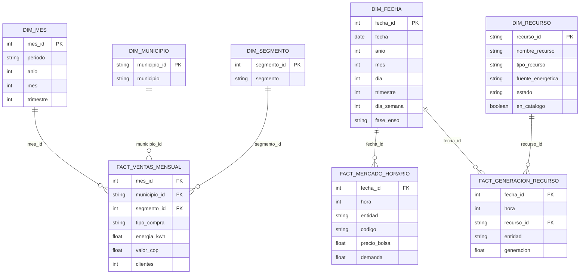

# Modelo dimensional de la capa oro — EA2

## 1. Objetivo

La capa oro del Observatorio de Energía y Clima permite
analizar las ventas de EnerAndes, el mercado eléctrico
horario y la generación por recurso de XM.

Se implementó un modelo dimensional con dbt y DuckDB,
compuesto por tres tablas de hechos y cinco dimensiones.

## 2. Diagrama del modelo dimensional



## 3. Granularidad de las tablas de hechos

La granularidad indica qué representa una fila.

| Tabla de hechos | Granularidad | Llave compuesta |
|---|---|---|
| fact_ventas_mensual | Una venta por mes, municipio, segmento y tipo de compra | mes_id, municipio_id, segmento_id, tipo_compra |
| fact_mercado_horario | Una observación por fecha, hora, entidad y código | fecha_id, hora, entidad, codigo |
| fact_generacion_recurso | Una observación por fecha, hora y recurso | fecha_id, hora, recurso_id |

## 4. Granularidad de las dimensiones

| Dimensión | Granularidad | Llave primaria |
|---|---|---|
| dim_mes | Un mes con ventas | mes_id |
| dim_municipio | Un municipio de EnerAndes | municipio_id |
| dim_segmento | Un segmento comercial | segmento_id |
| dim_fecha | Un día calendario | fecha_id |
| dim_recurso | Un recurso eléctrico XM | recurso_id |

## 5. Relaciones entre las tablas

### Ventas de energía

fact_ventas_mensual se relaciona con dim_mes,
dim_municipio y dim_segmento.

Permite analizar energía vendida, valor facturado
y clientes por municipio, período y segmento.

### Mercado eléctrico horario

fact_mercado_horario se relaciona con dim_fecha.

Permite estudiar el precio de bolsa y la demanda
por día, hora y fase ENSO.

### Generación eléctrica por recurso

fact_generacion_recurso se relaciona con dim_fecha
y dim_recurso.

Permite analizar la generación por planta o recurso,
fecha, hora y fuente energética disponible.

## 6. Tratamiento de recursos sin catálogo

Durante las pruebas de integridad se identificaron
22.003 registros de generación asociados con 10 códigos
que no aparecían en el catálogo de recursos de XM.

Para conservar la información histórica, dim_recurso
incluye también estos códigos.

Los recursos sin catálogo tienen:
- Su código original como recurso_id.
- Un nombre identificativo "Sin catalogo: CODIGO".
- Atributos desconocidos con valor NULL.
- en_catalogo = false.

De esta manera, no se eliminan registros de generación
ni se inventan características de las plantas.

## 7. Calidad e integridad

Los modelos se construyen con dbt-duckdb.

Se aplican pruebas de:
- Valores obligatorios (not_null).
- Unicidad de dimensiones (unique).
- Relaciones entre hechos y dimensiones (relationships).
- Valores aceptados (accepted_values).
- Unicidad de llaves compuestas en las tablas de hechos.

La ejecución se realiza desde la raíz del proyecto:

```powershell
dbt build --project-dir dbt --profiles-dir dbt
```

## 8. Consideraciones

La dimensión dim_mes representa meses comerciales,
mientras que dim_fecha representa días calendario.

La fase ENSO proviene del índice ONI de NOAA,
asignado a su mes central.

Las series de precipitación y temperatura IDEAM,
embalses y aportes hídricos XM continúan disponibles
en la capa plata. No se representan como tablas
de hechos independientes en este modelo oro.
